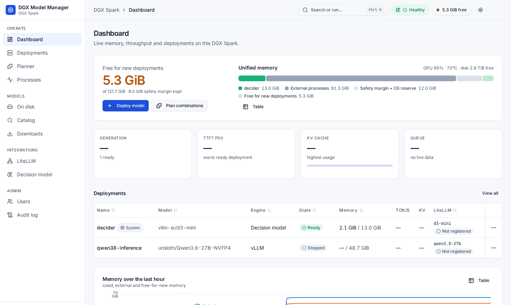

# DGX Model Manager (DGXMM)

DGXMM is a self-hosted web app for serving local LLMs on an NVIDIA DGX Spark (GB10, 128 GB unified
memory) or a similar single-GPU Linux box. It shows what is on disk and deploys models as vLLM or
llama.cpp containers. Before anything starts, a memory check estimates what the model needs and makes
sure it fits next to everything already running. You get live throughput, latency and KV-cache metrics,
tuning advice and benchmarks, and can register running models with a LiteLLM proxy. It runs in a single
container and installs with one command.



## Features

- **Memory-safe deploys.** A memory budget leaves headroom so a deployment cannot run the host out of
  memory. Every deploy is previewed first (estimate, fit, headroom). When a model does not fit, DGXMM
  offers plans (fp8 KV cache, shorter context, fewer sequences, a smaller quantization on disk, or
  sleeping or stopping lower-priority models) and does nothing until you confirm one.
- **vLLM and llama.cpp.** Hugging Face safetensors models run on vLLM and GGUF files run on llama.cpp.
  Extra engine flags are checked against an allowlist. The default vLLM image is pinned by digest.
- **Live metrics.** Tokens/s, time to first token, inter-token latency, KV-cache usage and queue depth
  are streamed to the browser. A 1-minute history is kept for 30 days.
- **Planner.** Shows which of your downloaded models can run together at a given context length.
- **Catalog.** Search Hugging Face with fit badges ("Fits now", "Fits if you evict", "Too big") based
  on the memory free right now, optional llmfit scores, and downloads into your HF cache.
- **Tuning advice and benchmarks.** Rule-based suggestions use measured metrics. A built-in load test
  measures throughput and latency at several concurrency levels.
- **Switch and reconfigure with rollback.** Replace a running model or change its settings. If the new
  one does not become ready, the old one is restored.
- **LiteLLM auto-registration.** Ready deployments (and their aliases) are added to and removed from a
  LiteLLM proxy automatically.
- **Users, roles and audit.** Admin and viewer roles. Every action is written to an audit log.
- **Modern UI.** Light and dark themes, responsive down to phone size, and a command palette
  (<kbd>⌘K</kbd> / <kbd>Ctrl K</kbd>).

## Quick start

**Requirements**

- Linux on arm64 or x86_64 with an NVIDIA GPU and driver (`nvidia-smi` works). DGX OS works as is.
- Docker Engine with the Compose v2 plugin (`docker compose version`).
- The NVIDIA Container Toolkit, registered as the Docker `nvidia` runtime.
- A normal user in the `docker` group (the installer refuses to run as root).
- Disk space for models. 50 GiB or more free is recommended.

**Install**

```bash
git clone https://github.com/nikghodki/dgxmodelmanager.git && cd dgxmodelmanager && ./install.sh
```

The installer checks the host and writes `.env` and `config.yaml` for your paths. It creates `data/`,
`secrets/` and the Docker network, then builds and starts the `dgxmm` container and waits for its
health check. At the end it prints something like:

```text
==> DGXMM is running. Open:
    http://192.0.2.10:8090/dgxmm/
    http://spark.local:8090/dgxmm/  (mDNS)
    http://spark:8090/dgxmm/
    admin user: admin   password: <generated>
    (shown once; also saved to secrets/admin_password. You must change it at first login.)
    manage: ./install.sh status | logs | upgrade | uninstall
```

Open one of the URLs (`http://<host>:8090/` redirects to `/dgxmm/`). Sign in as `admin` with the
printed password, then choose a new one of at least 12 characters. Next, deploy a model from
**Deploy model** or find one in **Catalog**.

> The first start runs a short one-off vLLM container to read which model architectures vLLM supports,
> so the vLLM image (several GB) is pulled in the background. Set `DGXMM_PULL_ENGINES=1` to pull both
> engine images during install instead.

## Common install options

Options are flags or environment variables. All of them are listed in `./install.sh --help`.

```bash
./install.sh --port 8091                                  # another UI port
DGXMM_BIND=127.0.0.1 ./install.sh                         # loopback only (behind a reverse proxy)
./install.sh --hf-cache /data/hf --models-dir /data/gguf  # where models live
HF_TOKEN=hf_xxx ./install.sh                              # token for gated Hugging Face models
LITELLM_URL=http://litellm:4000 LITELLM_MASTER_KEY=sk-xxx ./install.sh   # LiteLLM registration
./install.sh --with-litellm                               # also run a bundled LiteLLM: one /v1 endpoint for all models
DGXMM_BIND=127.0.0.1 DGXMM_NETWORK=gateway ./install.sh   # join an existing proxy's Docker network
```

Settings are written once to `.env`. After that, `.env` wins over flags: to change a setting, edit
`.env` and re-run `./install.sh`. For reverse proxies (nginx, Caddy), extra model directories and every
`config.yaml` key, see [docs/configuration.md](docs/configuration.md).

## Upgrade and uninstall

```bash
./install.sh upgrade          # git pull --ff-only, then rebuild and restart (your data is kept)
./install.sh status           # container health, URLs, running engines
./install.sh uninstall        # remove the container and image; keeps data/, secrets/, config
./install.sh uninstall --purge   # also delete DGXMM state and its engine containers
```

Running engine containers keep serving while DGXMM restarts. Model files (HF cache, models directory)
are never deleted.

## Documentation

| Guide | What it covers |
|---|---|
| [Usage](docs/usage.md) | Walkthrough of the UI: deploying, metrics, catalog, planner, users, calling your models |
| [Configuration](docs/configuration.md) | Every `config.yaml` key, `.env`, secrets, model directories, reverse proxy, LiteLLM |
| [Operations](docs/operations.md) | What the installer does, upgrades, backups, logs, troubleshooting, password reset |
| [Architecture](docs/architecture.md) | Components, deploy flow, memory model, state machine, data model, security model |
| [Contributing](CONTRIBUTING.md) | Development setup, tests, code layout |

## Security

- DGXMM mounts the Docker socket so it can start engine containers. **Access to the Docker socket is
  equivalent to root on the host.** Treat DGXMM admins as host admins.
- The default bind is `0.0.0.0` (your LAN). Do not expose that port to the internet. For remote access,
  install with `DGXMM_BIND=127.0.0.1` and put an HTTPS reverse proxy in front (see
  [configuration](docs/configuration.md#reverse-proxy)), or use a VPN.
- DGXMM only stops or removes containers labelled `dgxmm.managed=true`. Engine ports are published on
  `127.0.0.1` only.
- Logins use argon2id password hashes, HTTP-only SameSite=Strict cookies, CSRF tokens and rate limiting.
  See [operations](docs/operations.md#security-hardening) for hardening steps.

## License

MIT. See [LICENSE](LICENSE).
