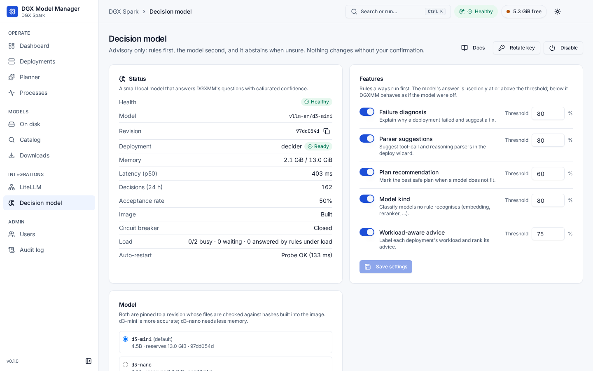
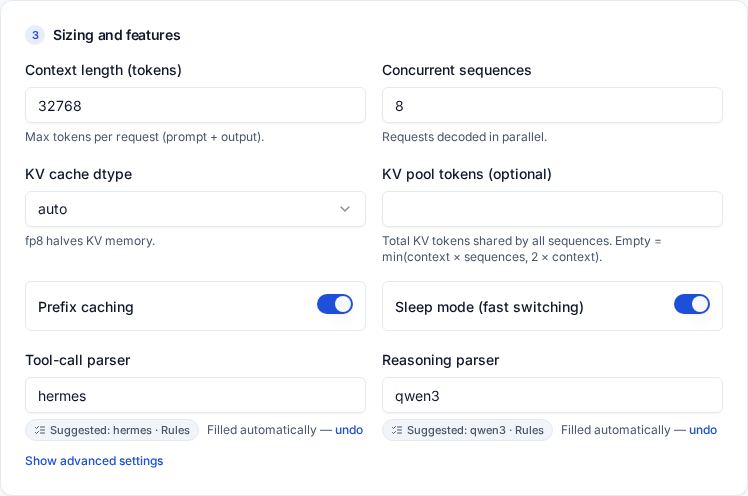
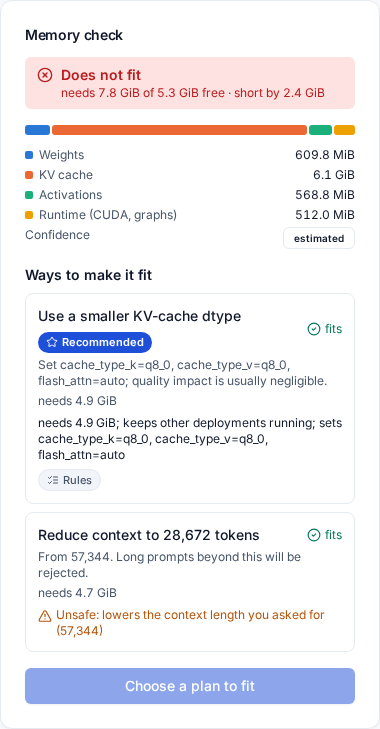
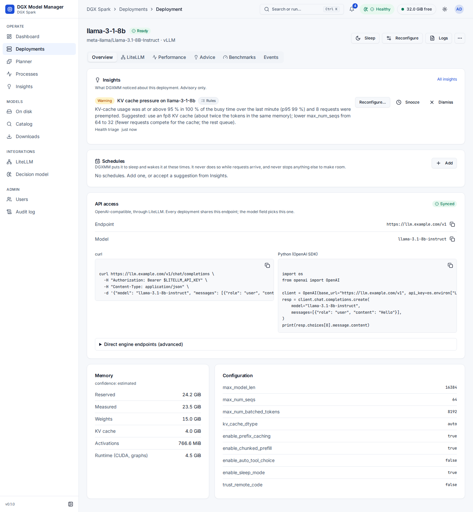

# DGX Model Manager (DGXMM)

DGXMM is a self-hosted web app for serving local LLMs on an NVIDIA DGX Spark (GB10, 128 GB unified
memory) or a similar single-GPU Linux box. It deploys the models on your disk as vLLM or llama.cpp
containers, checks before every start that a model fits next to everything already running, and
serves all of them through one OpenAI-compatible LiteLLM endpoint with virtual keys. An optional small
local decision model adds advice (why a start failed, which parser a model needs, which plan to pick),
always after DGXMM's own rules and never without your confirmation. It runs as a single container and
installs with one command.


## Features

**Deploy and memory safety**

- Every deploy is previewed first: an estimate split into weights, KV cache, activations and runtime,
  checked against a memory budget that keeps a safety margin, so a deployment cannot run the host out
  of memory.
- When a model does not fit, DGXMM offers plans (fp8 KV cache, shorter context, fewer sequences, a
  smaller quantization already on disk, or sleeping or stopping lower-priority deployments) and does
  nothing until you confirm one.
- Hugging Face safetensors models run on vLLM, GGUF files on llama.cpp. Extra engine flags are checked
  against an allowlist, and the default vLLM image is pinned by digest.
- Switch a deployment to another model or reconfigure it, with automatic rollback if the new one does
  not become ready. Estimates are calibrated from measured memory after each start.
- Engines start one at a time: a deployment started while another one loads waits as **Queued** with
  its memory reserved, so vLLM's start-up memory check is never disturbed.

**Smart features (optional decision model)**

All of them are advisory: rules run first, the model is asked only when no rule answers and its answer
is used only above a confidence threshold. The model is off by default; the rules work without it.

- **Failure diagnosis**: why a deployment failed (out of memory, KV cache too small, context too long,
  gated repo, bad parser, port in use, disk full, …) with a fix hint and **Apply fix…**, which prefills
  Reconfigure for you to review.
- **Parser suggestions**: the tool-call and reasoning parser for a model in the deploy wizard.
- **Plan recommendation**: unsafe plans (stopping a busy, depended-on or higher-priority deployment) are
  marked, and one safe plan is **Recommended**.
- **Model-kind detection**: embeddings, rerankers, drafts, speech, vision and classifier models are
  told apart from chat LLMs.
- **Workload-aware advice**: each deployment's traffic is labelled (chat, agent, batch, RAG, idle) and
  its tuning advice ordered by it.
- The model (`vllm-sr/d3-mini`, or the smaller `d3-nano`) runs locally in a locked-down container on an
  internal network; every answer shows its source (**Rules** or **AI** with its confidence) and can be
  rated. See [decision model](docs/usage.md#decision-model).

**Models and storage**

- **On disk** lists everything in the Hugging Face cache and your GGUF directories, with the engines
  that can serve each model.
- **Catalog** searches Hugging Face with fit badges (*Fits now*, *Fits if you evict*, *Too big*) and
  downloads into your HF cache. **Planner** shows which models can run together.
- **Delete** downloaded weights (a whole Hugging Face repo or a GGUF file with its shards) and **clean
  up** interrupted downloads. Models used by running deployments are protected, and root-owned files
  left by engine containers are removed by a short-lived, locked-down helper container.

**LiteLLM gateway**

- One endpoint for every model: each ready deployment is registered once in LiteLLM under its model
  name, so clients call a single `/v1` endpoint and pick the deployment with `"model"`. Model names are
  unique, and a name moves with **Switch model**, so clients keep working.
- **Virtual keys** with model restrictions, budgets, rate limits and expiry, managed from DGXMM's
  LiteLLM page or from a deployment's LiteLLM tab. A new key is shown once.
- Use your existing LiteLLM, or let `./install.sh --with-litellm` run a **bundled** LiteLLM with its own
  Postgres, already wired to DGXMM.

**Observability**

- A dashboard with free memory, a unified-memory bar, throughput, latency, KV-cache usage and queue
  depth, live over server-sent events; per-deployment charts with 30 days of 1-minute history.
- Tuning advice from measured metrics, and a built-in benchmark at several concurrency levels.
- **Processes**: every process using memory on the box, with its container, user, RAM and GPU memory
  and its command line, with passwords, tokens and keys masked.

**Administration**

- `admin` and `viewer` roles; every change is written to an audit log.
- Argon2id passwords, CSRF protection and login rate limiting; an admin command line for password
  resets and the decision model (`docker exec dgxmm python -m dgxmm.admin …`).
- Light and dark themes, a phone-sized layout and a command palette (<kbd>⌘K</kbd> / <kbd>Ctrl K</kbd>).

## Screenshots

| | |
|---|---|
|  |  |
| Decision model: status, features and thresholds | Dashboard (dark theme) |
|  |  |
| Parser suggestions in the deploy wizard | A plan recommended by the safety rules |
|  |  |
| A deployment's page | Deploy wizard with the memory check |
|  |  |
| LiteLLM: connection and registered models | A deployment's API access card |
|  |  |
| Models on disk with Delete and Clean up | Processes, grouped by container |

## Quick start

**Requirements**

- Linux on arm64 or x86_64 with an NVIDIA GPU and driver (`nvidia-smi` works). DGX OS works as is.
- Docker Engine with the Compose v2 plugin (`docker compose version`).
- The NVIDIA Container Toolkit, registered as the Docker `nvidia` runtime.
- A normal user in the `docker` group (the installer refuses to run as root).
- Disk space for models: 50 GiB or more free is recommended.
- For the optional decision model: about 13 GiB of free memory while it runs (9 GiB with d3-nano), 8.5 GiB
  in the HF cache, and 30 GB free on the Docker disk to build its image (the pinned vLLM base is about
  21 GB).

**Install**

```bash
git clone https://github.com/nikghodki/dgxmodelmanager.git && cd dgxmodelmanager && ./install.sh
```

To also run a bundled LiteLLM proxy (with its own Postgres) that serves every deployment on one
endpoint, add `--with-litellm`:

```bash
./install.sh --with-litellm
```

To also set up the local decision model (build its image, download and verify the model, enable it and
wait until it is healthy), add `--with-decider`. You can also enable it later in the UI under
**Integrations > Decision model**:

```bash
./install.sh --with-decider
```

The installer checks the host, writes `.env` and `config.yaml` for your paths, creates `data/`,
`secrets/` and the Docker network, then builds and starts the `dgxmm` container and waits for its
health check. It is non-interactive and safe to run again. At the end it prints something like:

```text
==> DGXMM is running. Open:
    http://192.0.2.10:8090/dgxmm/
    http://spark.local:8090/dgxmm/  (mDNS)
    http://spark:8090/dgxmm/
    admin user: admin   password: <generated>
    (shown once; also saved to secrets/admin_password. You must change it at first login.)
    manage: ./install.sh status | logs | upgrade | uninstall
```

With `--with-litellm` it then waits for LiteLLM and adds:

```text
==> LiteLLM is running. Single OpenAI-compatible endpoint for all DGXMM models:
    http://192.0.2.10:4000/v1
    ...
    from containers on network dgxmm: http://dgxmm-litellm:4000/v1
    every ready DGXMM deployment is one model on this endpoint: pass "model": "<model name>"
```

**First login.** Open one of the URLs (`http://<host>:8090/` redirects to `/dgxmm/`), sign in as
`admin` with the printed password and choose a new one of at least 12 characters. Then deploy a model
from **Deploy model**, or find one in **Catalog** first.

> The first start runs a short one-off vLLM container to read which model architectures vLLM supports,
> so the vLLM image (several GB) is pulled in the background. Set `DGXMM_PULL_ENGINES=1` to pull both
> engine images during install instead.

## Calling a model

Every ready deployment is one model on the LiteLLM endpoint, selected by its model name (shown on the
deployment's **API access** card). Create a virtual key on the **LiteLLM** page (admins) or on the
deployment's LiteLLM tab, then:

```bash
export LITELLM_API_KEY=sk-...                   # the virtual key, shown once when it is created
curl http://<host>:4000/v1/models -H "Authorization: Bearer $LITELLM_API_KEY"
curl http://<host>:4000/v1/chat/completions \
  -H "Authorization: Bearer $LITELLM_API_KEY" \
  -H 'Content-Type: application/json' \
  -d '{"model": "default-chat", "messages": [{"role": "user", "content": "Hello!"}]}'
```

`http://<host>:4000` is the bundled LiteLLM; with your own LiteLLM, use its public URL. Any OpenAI SDK
works the same way (`base_url="http://<host>:4000/v1"`). Python snippets and direct engine endpoints are
in [usage](docs/usage.md#calling-your-models).

## Common install options

Options are flags or environment variables; `./install.sh --help` lists all of them.

| Goal | Command |
|---|---|
| Another UI port | `./install.sh --port 8091` |
| Bind to loopback, behind a reverse proxy | `DGXMM_BIND=127.0.0.1 ./install.sh` |
| Join an existing proxy's Docker network | `DGXMM_BIND=127.0.0.1 DGXMM_NETWORK=gateway ./install.sh` |
| Trust a reverse proxy's `X-Forwarded-For` | `DGXMM_TRUSTED_PROXIES=172.18.0.0/16 ./install.sh` |
| Where models live | `./install.sh --hf-cache /data/hf --models-dir /data/gguf` |
| Token for gated Hugging Face models | `HF_TOKEN=hf_xxx ./install.sh` |
| Bundled LiteLLM (one `/v1` endpoint) | `./install.sh --with-litellm` (`--litellm-port 4001` for another port) |
| Local decision model (diagnosis, suggestions, ~13 GiB GPU memory) | `./install.sh --with-decider` (see [decision model](docs/operations.md#decision-model)) |
| Remove it again with its model files | `./install.sh uninstall --purge --purge-decider-model` |
| Register with an existing LiteLLM | `LITELLM_URL=http://litellm-proxy:4000 LITELLM_MASTER_KEY=sk-xxx ./install.sh` |
| See what would happen | `./install.sh --dry-run` |

Settings are written once to `.env`. After that, `.env` wins over flags: to change a setting, edit
`.env` and re-run `./install.sh`. The LiteLLM connection can also be changed at runtime on the LiteLLM
page. For reverse proxies, extra model directories and every `config.yaml` key, see
[configuration](docs/configuration.md).

## Upgrade and uninstall

```bash
./install.sh upgrade             # git pull --ff-only, then rebuild and restart (your data is kept)
./install.sh status              # container health, URLs, running engines
./install.sh logs [-f]           # DGXMM container log
./install.sh uninstall           # remove the container and image; keeps data/, secrets/, config
./install.sh uninstall --purge   # also delete DGXMM state and its engine containers
```

Running engine containers keep serving while DGXMM restarts. Model files (HF cache, models directory)
are never deleted by the installer. Before upgrading, read
[upgrading an existing install](docs/operations.md#upgrading-an-existing-install) and the
[changelog](CHANGELOG.md).

## Documentation

| Guide | What it covers |
|---|---|
| [Usage](docs/usage.md) | The UI page by page: deploying, the start-up queue, deployment detail, models on disk, catalog, planner, processes, LiteLLM and virtual keys, the [decision model](docs/usage.md#decision-model), users, calling your models |
| [Configuration](docs/configuration.md) | Every `config.yaml` key, `.env` and installer variables, secrets, model directories, reverse proxy, LiteLLM and the bundled LiteLLM, decision-model settings, API limits |
| [Operations](docs/operations.md) | What the installer does, upgrading, the decision model, backups, logs, freeing disk space, admin command line, troubleshooting, known limitations |
| [Architecture](docs/architecture.md) | Components, deploy flow, memory model, state machine, start-up queue, watchdog, decision model, LiteLLM sync, weight deletion, process view, HTTP API, security model |
| [Security](docs/security.md) | Threat model: assets, trust boundaries, the decision model's container, network, key and supply chain, residual risks |
| [Decision-model evaluation](docs/decider-evaluation.md) | How the decision model's features and thresholds were checked on real data, and its performance and capacity |
| [Changelog](CHANGELOG.md) | What changed in each release |
| [Contributing](CONTRIBUTING.md) | Development setup, tests, code layout |

## Security

- DGXMM mounts the Docker socket so it can start engine containers. **Access to the Docker socket is
  equivalent to root on the host.** Only give the `admin` role to people you would trust with root.
- The default bind is `0.0.0.0` (your LAN). Do not expose that port to the internet. For remote access,
  install with `DGXMM_BIND=127.0.0.1` behind an HTTPS reverse proxy (see
  [configuration](docs/configuration.md#reverse-proxy)), or use a VPN.
- DGXMM only stops or removes containers labelled `dgxmm.managed=true`, plus the short-lived delete
  helpers it starts itself (`dgxmm.helper=true`). Engine ports are published on `127.0.0.1` only and
  have no authentication: give other machines access through LiteLLM and virtual keys.
- The LiteLLM master key is write-only: DGXMM never shows or logs it, and only sends it to the LiteLLM
  URL it was entered for. A virtual key is shown once, when it is created.
- Process command lines are visible to every signed-in user. Secrets in them are masked on a
  best-effort basis, so do not pass secrets as command-line arguments (see
  [known limitations](docs/operations.md#known-limitations)).
- The optional decision model runs as an unprivileged, read-only container on an internal network with no
  published port; its bearer key is delivered as a file and can be rotated.
- See [security hardening](docs/operations.md#security-hardening) and the
  [threat model](docs/security.md) for more.

## License

MIT. See [LICENSE](LICENSE).
