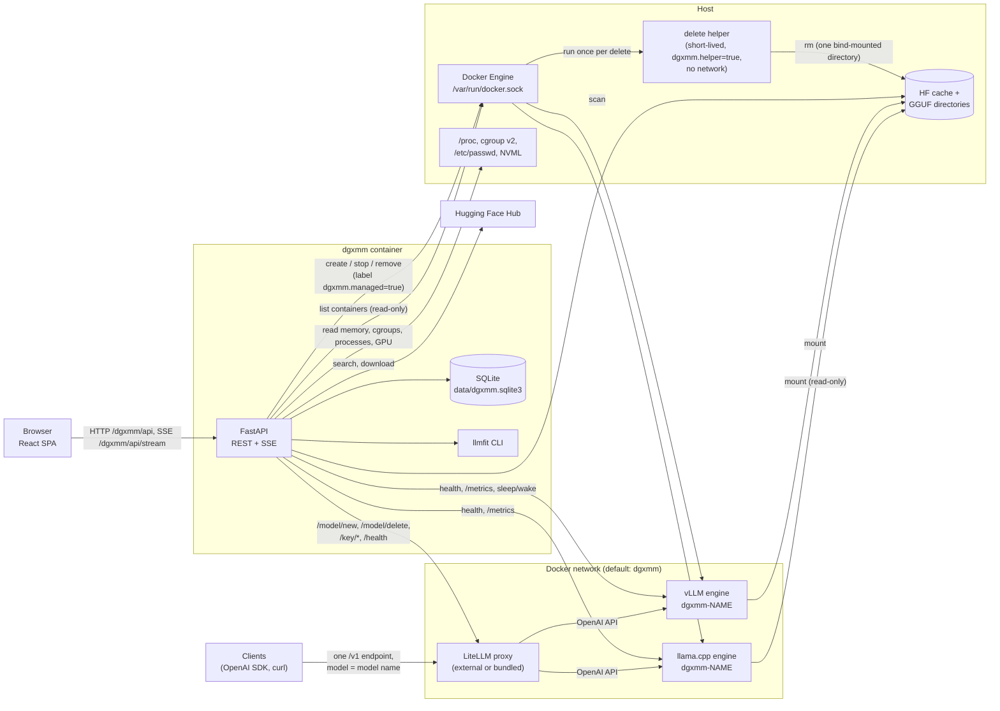
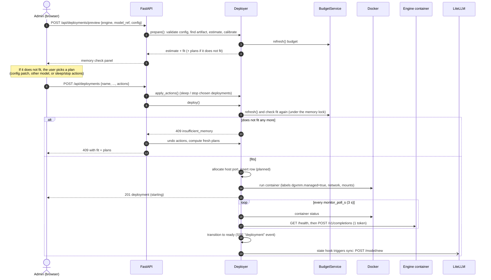
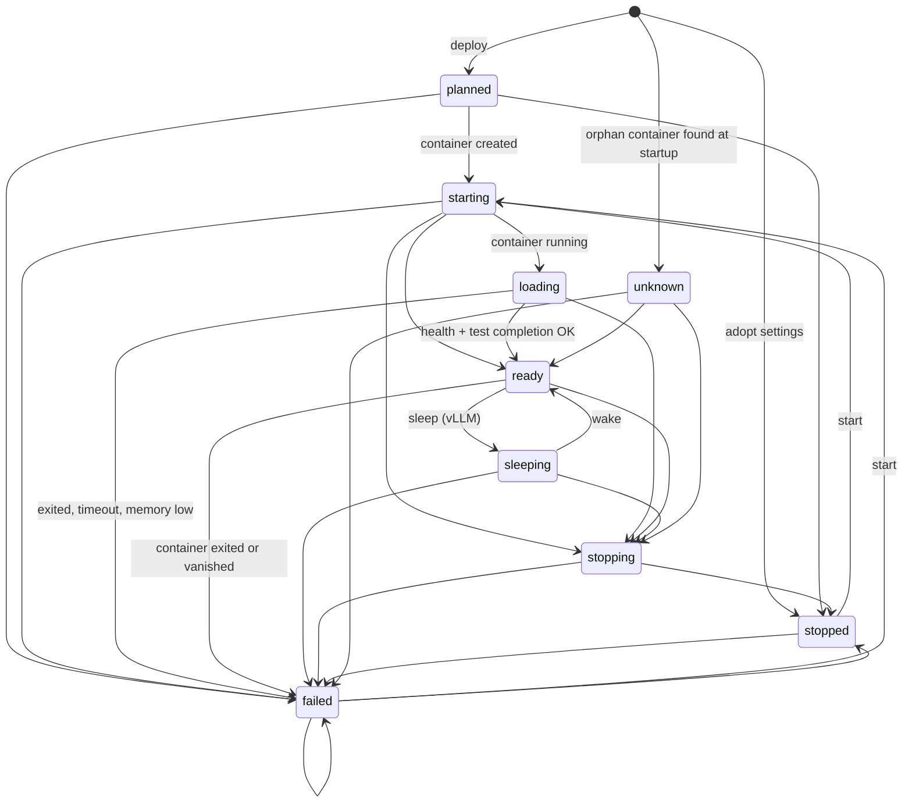

# Architecture

This page explains how DGXMM works inside. You do not need it to use DGXMM. Read it to understand
DGXMM's decisions or to change the code. Each section names the source files it describes.

- [Components](#components)
- [Backend module map](#backend-module-map)
- [Deploying a model, step by step](#deploying-a-model-step-by-step)
- [Memory model](#memory-model)
- [Deployment state machine](#deployment-state-machine)
- [Switch and reconfigure with rollback](#switch-and-reconfigure-with-rollback)
- [Watchdog](#watchdog)
- [LiteLLM integration](#litellm-integration)
- [Deleting weights](#deleting-weights)
- [Process view](#process-view)
- [Startup and background loops](#startup-and-background-loops)
- [Data model](#data-model)
- [HTTP API](#http-api)
- [Frontend](#frontend)
- [Security model](#security-model)

## Components

DGXMM is a single container (`dgxmm`). It holds a FastAPI backend, the built React single-page app
and a SQLite database. Everything else it uses is an existing service or a container it starts.



- **Browser.** The UI is served from `/dgxmm/` by the same process. A server-sent event (SSE) stream
  pushes memory, deployment, download, metric and alert updates.
- **FastAPI.** Uvicorn listens on port 8090 in the container (`dgxmm/__main__.py`). All routes live
  under the base path `/dgxmm` (`dgxmm/app.py`), and `/` redirects there.
- **SQLite.** One file, `data/dgxmm.sqlite3`, in WAL mode. The schema is created on start
  (`Base.metadata.create_all`), so new tables appear automatically. There is no migration framework.
  It also holds the runtime settings (`app_settings`) that the UI can change.
- **Docker API.** DGXMM starts engine containers through the mounted Docker socket. Engines join the
  configured Docker network, where DGXMM reaches them as `http://dgxmm-<name>:<port>`. Their ports are
  also published on the host at `publish_bind` (default `127.0.0.1`).
- **Host probes.** `/proc`, `/sys/fs/cgroup` and `/etc/passwd` are mounted read-only. DGXMM reads
  `/proc/meminfo`, each engine container's `memory.stat` (cgroup v2 path `system.slice/docker-<id>.scope`)
  and per-process data (see [process view](#process-view)). NVML (via the `nvidia` runtime) adds GPU
  utilisation, temperature, power and per-process GPU memory.
- **Delete helper.** To delete model files that engine containers left owned by root, DGXMM starts a
  short-lived, locked-down container that runs `rm` on one bind-mounted directory (see
  [deleting weights](#deleting-weights)).
- **LiteLLM** (optional; an existing proxy or the bundled one). Each ready deployment is registered once
  through LiteLLM's model management API, so clients use a single OpenAI-compatible endpoint. DGXMM
  also proxies LiteLLM's virtual-key API for the UI (see [LiteLLM integration](#litellm-integration)).
- **Hugging Face Hub.** Catalog search, model details and downloads (with the optional HF token).
- **llmfit.** A Python CLI bundled in the image. It adds fit levels, scores and expected tok/s to
  catalog results. It never decides whether a deploy may proceed.

## Backend module map

| Module | Responsibility |
|---|---|
| `__main__.py` | Entry point: loads settings and runs Uvicorn on `0.0.0.0:8090` with proxy headers enabled. |
| `admin.py` | Admin command line (`python -m dgxmm.admin reset-password` / `list-users`). |
| `app.py` | FastAPI factory: lifespan (startup tasks, background loops), routers, root redirect, SPA fallback. |
| `config.py` | `Settings` model: optional YAML file, then `DGXMM_<KEY>` environment overrides. |
| `context.py` | Wires every service into an `AppContext` and defines the startup and background tasks. |
| `db.py` | SQLAlchemy models and the SQLite engine (WAL, foreign keys, busy timeout). |
| `events.py` | In-process publish/subscribe used by the SSE stream (slow clients drop their oldest events). |
| `audit.py` | Writes audit log rows. |
| `auth/` | `bootstrap` (first admin), `passwords` (argon2id), `sessions`, `ratelimit`, `deps` (auth, CSRF, roles). |
| `settings_store.py` | Runtime settings in the `app_settings` table, with a cache and typed accessors (LiteLLM URLs, master key and its URL binding, enabled). |
| `api/` | HTTP routers: auth, users, host (incl. processes), inventory (incl. delete and clean-up), engines, deployments, integrations (LiteLLM), stream, audit, containers, catalog, downloads, planner, metrics. |
| `deployer/service.py` | Deployment lifecycle: prepare, preview, deploy, monitor, stop, restart, sleep/wake, switch, reconfigure. |
| `deployer/states.py` | Deployment states and allowed transitions. |
| `deployer/reconcile.py` | After a restart: brings the database in line with the containers that actually exist. |
| `deployer/adopt.py` | Copies the settings of an unmanaged vLLM container into a new, stopped deployment. |
| `docker_ctl.py` | The only module that calls Docker. Every write requires the `dgxmm.managed=true` label, except the delete helpers it creates itself (`dgxmm.helper=true`). Also holds the read-only, cached container directory (id → name, image, deployment). |
| `engines/` | Engine plug-ins (`vllm`, `llamacpp`): config schema, container spec, health check, metrics parsing, sleep. `argguard` holds the extra-flag allowlist and `prom` parses Prometheus metrics. |
| `memory/estimate.py`, `kv.py` | Memory estimates per engine (weights, KV cache, state, activations, runtime). |
| `memory/budget.py` | The host memory budget and `free_for_new`. |
| `memory/hostmem.py` | Reads `/proc/meminfo`, container cgroups, processes (with container, user and command) and NVML. |
| `memory/redact.py` | Masks secrets in process command lines before they leave the probe. |
| `memory/calibration.py` | Corrects estimates with measured usage and out-of-memory kills. |
| `planner/fit.py`, `plans.py` | Fit check and "ways to make it fit" plans. |
| `planner/colocate.py` | "What runs together" combinations for the Planner page. |
| `inventory/` | Scans the HF cache and GGUF roots; parses `config.json` and GGUF headers into architecture specs. `weights.py` plans and performs weight deletion and incomplete clean-up. |
| `catalog/` | Hugging Face search and details (`hub`), llmfit wrapper, vLLM-supported architectures (`support`), fit badges. |
| `downloads.py` | Background Hugging Face downloads with a disk-space guard. |
| `metrics/` | Engine `/metrics` scraper and storage (live ring buffer plus 1-minute rollups). |
| `advisor/` | Tuning rules (`rules`) and the built-in load test (`benchmark`). |
| `watchdog.py` | Memory alerts and optional automatic protection. |
| `litellm.py` | LiteLLM client (URL and key resolved per call, errors scrubbed of keys, cached status) and the sync that keeps LiteLLM's model list in line with ready deployments. |

## Deploying a model, step by step

The deploy wizard calls `preview` repeatedly while you edit the form (with a 350 ms debounce). Only the
final **Deploy** call changes anything.



Details (`dgxmm/deployer/service.py`):

- **prepare** validates the engine config (unknown keys are rejected, and extra flags must be on the
  allowlist). It checks that the model reference is a Hugging Face repo id or a `.gguf` path under an
  allowed root, and that the artifact is fully downloaded and supported by the engine. Then it estimates
  memory and applies calibration.
- **Fit** is `estimate.total <= free_for_new (+ memory the chosen actions free)` (`planner/fit.py`).
- **Container creation** runs under a global memory lock, so two deploys cannot both claim the same
  free memory. vLLM gets `--gpu-memory-utilization = ceil(reservation / MemTotal × 100) / 100`, so its
  memory pool matches the reservation. vLLM containers run with `HF_HUB_OFFLINE=1`: they only use files
  already in the cache.
- **Readiness**: the monitor marks the deployment `loading` once the container runs, and `ready` once
  `/health` returns 200 and a one-token completion succeeds. It fails the deployment if the container
  exits (exit 137 is reported as "likely out of memory" and recorded for calibration), if
  `MemAvailable` falls below the safety margin during startup, or after `startup_timeout_s` (900 s).
  On failure the container is removed and its last 200 log lines are kept in the event history.
- **LiteLLM**: a state hook wakes the sync loop whenever a deployment enters or leaves `ready`.

## Memory model

### Budget

On the GB10, CPU and GPU share one pool of memory, so DGXMM budgets host memory as a whole
(`memory/budget.py`):

```text
usable       = MemTotal − safety_margin_gib − os_reserve_gib            (defaults 8 GiB and 4 GiB)
committed    = Σ max(reserved, measured)  for starting / loading / ready / unknown deployments
             + Σ measured                for sleeping / stopping deployments
external     = max(used − measured_by_managed − ready_gap, 0)           used = MemTotal − MemAvailable
free_for_new = usable − committed − external
```

- *measured* is the engine container's cgroup `anon` + `kernel` memory.
- *external* is everything DGXMM does not manage (desktop, notebooks, other containers). DGXMM never
  touches it. The Dashboard lists the largest external processes with their container, user, masked
  command line, RSS and GPU memory (see [process view](#process-view)).
- **GB10 unified memory:** CUDA allocations are not charged to the container's cgroup, so a running
  model's memory shows up in `used` but only partly in *measured*. For `ready` deployments the gap
  between reservation and measurement (`ready_gap`) is credited back, so it does not appear as external
  usage. It is never credited for deployments that are still starting, which keeps the check
  conservative while memory is still growing.

The budget is refreshed every `budget_interval_s` (2 s) and pushed to browsers over SSE.

### Estimates

Each deploy gets an estimate (`memory/estimate.py`). The total is the sum of its parts:

| Part | vLLM | llama.cpp |
|---|---|---|
| weights | size of the safetensors files (plus a speculative draft model's weights) | size of the GGUF file |
| KV cache | from `config.json`: layers, KV heads, head size, KV dtype, attention window, for the KV pool (`kv_tokens`, default `min(context × seqs, 2 × context)`) | from GGUF metadata for `ctx_size` across `parallel` slots, K/V cache types |
| state | recurrent state of SSM and hybrid layers, per sequence | same |
| activations | from batched tokens, hidden and intermediate sizes, and vocabulary | compute buffers from `n_ubatch` |
| runtime | `vllm_runtime_fixed_gib` + `vllm_cuda_graph_gib` (3.0 + 1.5 GiB) | `llamacpp_runtime_fixed_gib` (0.5 GiB) |
| margin | +20 % of KV + state + activations when `config.json` lacks fields the formula needs | same |

The estimate's **confidence** is `low` (fields were missing), `estimated`, `calibrated` or `measured`.

### Calibration

Fifteen seconds after a deployment becomes ready, DGXMM records its measured memory next to the formula
estimate (`memory/calibration.py`). Later estimates for the same model are corrected:

- **Same model and exact same configuration:** `max(measured × 1.05, formula)`. Confidence: `measured`.
- **Same model, other configuration:** the formula is scaled by the mean measured/estimated ratio of
  the last 5 measurements, clamped to 1.0–1.5. Confidence: `calibrated`.
- **Out-of-memory kill (exit 137):** the next estimate for that configuration gets +10 %. It never drops
  back below 1.1 × the size that was killed.

Calibration only raises estimates. It never lowers one below the formula.

### Plans when it does not fit

`planner/plans.py` offers, in this order (options that fit are listed first):

1. a smaller KV cache dtype (vLLM `kv_cache_dtype=fp8`; llama.cpp `q8_0` K and V cache);
2. a shorter context: the largest of context/2, /4, … (at least 4096) that fits;
3. fewer concurrent sequences / slots;
4. a smaller quantization of the same base model that is already on disk;
5. putting lower-priority, sleep-capable vLLM deployments to sleep (frees roughly KV cache and
   activations);
6. stopping deployments, lowest priority first (and largest first within a priority).

Sleep and stop plans run their actions first, then deploy. If the deploy still fails, those actions are
undone.

## Deployment state machine

States and transitions come from `dgxmm/deployer/states.py`. `unknown` is the state of a running managed
container that DGXMM found without a database record (see [reconcile](#startup-and-background-loops)).



Every transition writes a `deployment_events` row (with a log tail on failures) and publishes an SSE
event. A deployment can only be removed when it is `stopped` or `failed`. On every budget refresh, a
liveness check moves `ready`, `sleeping` and `unknown` deployments whose container exited or vanished
to `failed`.

**Sleep** (vLLM only, and only when started with `enable_sleep_mode`, which is the default) calls the
engine's `/sleep?level=1`. That frees the KV cache while the model stays loaded for a fast wake-up.
**Wake** first checks that the memory it will take back is free.

## Switch and reconfigure with rollback

**Switch** (`Deployer.switch`) replaces deployment A with a new deployment B:

1. Estimate B. The memory A frees counts as available. DGXMM sleeps A when that frees enough, and stops
   it otherwise, unless you chose what happens to A yourself. Any other plan actions are added.
2. If it still does not fit, return `409` with fresh plans and change nothing.
3. Apply the actions. Move A's LiteLLM model name (its alias) to B. Deploy B and wait for `ready` (up to
   `startup_timeout_s` + 30 s).
4. **Rollback** if B does not become ready: stop and remove B, give the alias back to A, and undo every
   action in reverse order (wake what was slept, restart what was stopped). If any undo step fails,
   the error is `rollback_incomplete` and lists what could not be restored.

**Reconfigure** (`Deployer.reconfigure`) changes the configuration (or model) of one deployment in
place. It stops the deployment and restarts it with the new config. If that does not become ready, the
old config is written back and the deployment is restarted with it, then any plan actions are undone.

## Watchdog

`dgxmm/watchdog.py` runs after every budget refresh and looks at `MemAvailable`:

| Level | Condition |
|---|---|
| `ok` | `MemAvailable` ≥ 1.5 × safety margin |
| `warning` | `MemAvailable` < 1.5 × safety margin (12 GiB by default) |
| `critical` | `MemAvailable` < safety margin (8 GiB by default) |

Level changes are logged and sent to the UI as an alert banner. If `auto_protect: true` and the level is
`critical`, the watchdog stops the lowest-priority `ready`, `sleeping` or `unknown` deployment (the
largest reservation goes first within the same priority). It acts at most once every 60 seconds and
audits the stop as `watchdog_stop`. With the default `auto_protect: false` it only warns.

## LiteLLM integration

**Settings store** (`settings_store.py`). The LiteLLM connection is resolved on every call from the
`app_settings` table, falling back to `config.yaml`: internal URL (`litellm.url` > `litellm_url`), public
URL (`litellm.public_url` > `litellm_public_url`), master key (`litellm.master_key` > the
`litellm_key_file` secret) and `litellm.enabled` (default: on when a key is available). Values are cached
in memory and the cache is updated on write, so a change made on the LiteLLM page applies to the next
call without a restart.

**Master key bound to its URL.** A stored key is saved together with the internal URL in effect at that
moment (`litellm.master_key_url`) and is used only while the internal URL is still that URL. The
secret-file key is used only with the configured default `litellm_url`. Pointing the internal URL at
another host therefore never sends an existing write-only key there; the API reports
`master_key_hint` instead and the UI asks for the key. The key is never returned by the API, never
logged and never audited, and error texts from LiteLLM are scrubbed of the key, `sk-…` tokens and key
hashes before they are logged or returned.

**One registration per deployment** (`LiteLLMSync`). The desired state is one entry per `ready`
deployment, keyed by deployment id and model name (`alias` or served name), with
`model_info.dgxmm_id` marking it as DGXMM's. Each sync lists the models carrying a `dgxmm_id`, deletes
every one that is not desired (stopped deployments, an old model name after a rename, duplicates, and
the second, served-name entry that older versions registered next to an alias), and adds what is
missing. That makes the migration from the old two-name scheme automatic on the first sync, and a
rename re-registers exactly once. Syncs are serialised by a lock. If two ready deployments end up with
one name anyway (the deployer prevents it when names are claimed), the oldest keeps it and the others
get `litellm_status: error` with a `model_name_conflict` reason. The last sync's result and conflicts
feed `litellm_error` in deployment views and the per-deployment `GET /deployments/{id}/litellm`, so
those read paths never call LiteLLM.

**Model names are unique.** The deployer checks names under its memory lock when a deployment is
deployed, started, woken or renamed: a name is taken if it is another deployment's alias (in any state)
or the model name of another deployment that is planned, starting, loading, ready or unknown.

**Virtual keys** are proxied to LiteLLM's `/key/*` API with the master key. Before a key operation DGXMM
checks LiteLLM's `/health/readiness`; without a connected database it answers `409 litellm_no_db`.
Keys are identified by their hash; the full key is returned only in the create response. Keys created
by DGXMM carry `metadata.created_by = "dgxmm"` and the user name.

**Status** (`GET /api/integrations/litellm`, or on its own `GET /api/integrations/litellm/status`) uses
only unauthenticated calls (`/health/liveliness`, `/health/readiness`, and `/openapi.json` for the
version), cached for 15 seconds. The probe has a 4 s deadline; a slower version fetch finishes in the
background and fills in the cached status. `GET /api/integrations/litellm?probe=false` returns the
settings at once with the cached status (or `null`); the LiteLLM page uses it so the probe never holds
the page up. **Test connection** is always fresh and also checks the key with an authenticated
`/model/info`. `GET /api/integrations/litellm/models` caches LiteLLM's model list for 15 seconds (DGXMM's
own registrations invalidate it).

**Leaving a LiteLLM.** A `PUT /api/integrations/litellm` that disables the integration or changes the
internal URL first deletes every model with `model_info.dgxmm_id` from the LiteLLM in effect before the
change, using the key bound to that URL, under the sync lock (so the sync loop cannot re-register in
between), then saves. It is best effort (15 s bound): the response carries `deregistered`,
`deregister_error` and a `warning` naming the old URL when some may remain; the audit entry records the
count and error. The settings are saved either way.

## Deleting weights

`inventory/weights.py` plans and performs deletions; the API (`DELETE /api/inventory?ref=`, with
`GET /api/inventory/delete-preview` and `/api/inventory/cleanup-incomplete[/preview]`) is admin-only.

**Plan.** A Hugging Face ref maps to `<hub>/models--org--name` plus its `.locks` directory. A GGUF path
maps to the file and all its split shards. When a GGUF inside the HF cache is a snapshot symlink, the
blob it points to is deleted too, unless another snapshot link still uses that blob (then only the link
goes, and 0 bytes are reported).

**Safety rules**, enforced on the server:

- **Containment.** Refs containing `..` are refused. Both the link location and the fully resolved path
  must lie inside the HF hub or a configured GGUF root, so symlinks cannot escape. A target that is, or
  contains, a configured root (hub, `hf_cache.local`, `.locks`, a GGUF root) is refused (`400
  unsafe_path`). Symlink loops and other path errors are refused the same way.
- **In use.** Every deployment's model and draft model are mapped to paths. A non-terminal deployment
  whose paths lie in a target blocks the delete (`409 model_in_use`, listing the deployments). Stopped
  and failed ones are returned as warnings.
- **Downloads.** A queued or running download of the repo blocks it (`409 download_active`).
- **Races.** The deleter publishes the targets it is about to delete, then plans again with a fresh
  database read. Deploy, start, restart, switch, reconfigure and download starts check those markers
  (and check again after creating their row), so either the deleter sees the new deployment or the
  deployment sees the deletion and is refused (`409 model_being_deleted`). Deletions are serialised.

**Execution.** One helper container runs per parent directory, from DGXMM's own image (`helper_image`;
it is never pulled):

- user `0:0`, so files left owned by root by engine containers can be removed;
- one bind mount: the target's parent host directory at `/x`, and nothing else;
- command `rm -rf -- /x/<name>…` (`rm -f` for files) as the entrypoint;
- `network_mode: none`, read-only root filesystem, all capabilities dropped except `DAC_OVERRIDE` and
  `FOWNER`, `no-new-privileges`, a process limit, `auto_remove`;
- label `dgxmm.helper=true` (never `dgxmm.managed`), and a `helper_timeout_s` (120 s) limit after which
  only that container is force-removed.

Anything the helper could not remove, or everything when the helper cannot run (no Docker, image
missing), is deleted in-process. A permission error there fails with `500 delete_failed` and a
`sudo chown -R <uid>:<gid> <path>` hint. Afterwards the inventory is refreshed. Every deletion, refusal
and failure is audited (`model_delete`, `model_delete_refused`, `model_delete_failed`; clean-ups add one
`incomplete_cleanup` summary row).

**Incomplete clean-up** applies the same rules to artifacts that are not complete only. Complete models
are never deleted through it, and Hugging Face repos with a partial blob written in the last 10 minutes
are skipped as `recently_active`.

## Process view

`memory/hostmem.py` scans `/proc` for `GET /api/host/processes` and for the external processes in the
budget. Per process it reads `status` first and skips kernel threads, zombies and processes with no
RSS and no GPU memory, then reads `cgroup` (to find the Docker container id) and `cmdline`.
`/proc/<pid>/environ` is never opened. GPU memory comes from NVML.

- **User.** Host processes get their name from the host's `/etc/passwd` (re-read when it changes).
  Processes in containers show the uid as seen inside the container, because container uids are not
  host accounts.
- **Container.** The cgroup's container id is resolved to name and image through the container
  directory in `docker_ctl.py`: one read-only `docker ps` listing, cached for 30 seconds and refreshed by
  a background loop. A miss may refresh early, at most every 5 seconds; Docker errors keep the last
  map. The budget loop only reads the cache, so it never waits for Docker.
- **Managed.** A process is DGXMM-managed when its container is an active deployment's container. A
  container with DGXMM labels that is not an active deployment is reported as `dgxmm_label`, and its
  memory counts as external.
- **Command.** `memory/redact.py` masks passwords, tokens and keys in the argv before it leaves the
  probe. Values that cannot be parsed reliably are masked as a whole (fail closed), and input size is
  capped so masking cost stays bounded. The result is shell-quoted and cut at 4 KiB. Masking is
  best-effort and favours over-masking; `tests/test_redact.py` documents the cases it covers.

Viewers and admins get the same masked data. The scan runs in a worker thread and takes tens of
milliseconds on a DGX Spark.

## Startup and background loops

At startup, before the first request is served (`context.py`):

1. **Bootstrap.** If there are no users, create `admin` with a random password and
   `must_change_pw=True`, and log it once.
2. **Recover downloads.** Downloads that were queued or running are marked failed (they do not survive
   a restart).
3. **Inventory.** Scan the HF cache and GGUF roots.
4. **Reconcile** (`deployer/reconcile.py`). Compare the database with the managed containers that
   exist:
   - a missing container marks its deployment `failed`;
   - an exited container is failed with its exit code;
   - a deployment still `starting` or `loading` gets its monitor back;
   - an interrupted `stopping` is finished;
   - a running managed container with no record is recorded as an `unknown` deployment.

   Because DGXMM adopts every container labelled `dgxmm.managed=true`, only one DGXMM instance may run
   per Docker host.

Background loops:

| Loop | Interval | Does |
|---|---|---|
| Budget | `budget_interval_s` (2 s) | Refresh memory, push SSE `budget`, run the watchdog and the liveness check. |
| Metrics scraper | `scrape_interval_s` (5 s) | Scrape each ready engine's `/metrics` and record host samples. Roll up to 1-minute rows every 60 s and drop rollups older than 30 days. |
| Inventory | `inventory_interval_s` (300 s) | Rescan model directories. |
| LiteLLM sync | when a deployment enters or leaves `ready`, its model name changes or the LiteLLM settings change, else every 60 s | Add missing registrations and remove stale ones (one entry per ready deployment). After a failure it retries in 5 s, doubling up to 600 s. |
| Container directory | 30 s | Refresh the read-only container id → name/image map used by the process view. |
| vLLM architectures | once | Run a one-off container from the vLLM image to list supported architectures. The result is cached in `data/` per image reference. |
| Deployment monitor | `monitor_poll_s` (3 s), per deployment | Only while starting or loading. |
| Calibration | 15 s after ready | Record measured memory. |

## Data model

SQLite tables (`dgxmm/db.py`):

| Table | Contents |
|---|---|
| `users` | username, argon2id hash, role (`admin` / `viewer`), `must_change_pw` |
| `sessions` | SHA-256 of the session token, user, CSRF token, client IP, expiry |
| `deployments` | name, engine, model reference, validated config, state, container id, port, priority, alias (the LiteLLM model name), reservation and estimate, LiteLLM status, last error and exit code |
| `app_settings` | runtime settings changed in the UI (key, value, updated at): the LiteLLM URLs, enabled flag, master key and the URL it is bound to |
| `deployment_events` | state transitions with message and optional log tail |
| `memory_calibration` | estimated vs measured bytes per engine, model and config hash; OOM records |
| `benchmarks` | one row per concurrency level: TTFT p50/p95, ITL p50, total and per-request tok/s |
| `metric_rollups` | 1-minute aggregates per deployment and for the host (30-day retention) |
| `downloads` | repo, revision, files, progress, state, error |
| `favourites` | model references starred in the Planner |
| `audit_log` | user, action, target, details, timestamp |

Live metrics (about the last hour at the scrape interval) are kept in memory only.

## HTTP API

Every route is under `/dgxmm/api` (`dgxmm/api/`). All of them except login need a session; *user* means any
signed-in user (`viewer` or `admin`). With a session, every request other than GET must also send the
session's CSRF token in `X-CSRF-Token`. The UI uses exactly
these routes, so this is also the API for scripts.

| Area | Routes | Role |
|---|---|---|
| Auth | `POST /auth/login`, `POST /auth/logout`, `GET /auth/me`, `POST /auth/change-password` | login: none; others: user |
| Host | `GET /host` (budget, GPU, disk), `GET /host/processes?scope=all\|external\|managed&limit=50` | user |
| Deployments | `GET /deployments`, `GET /deployments/{id}`, `GET /deployments/{id}/litellm`, `POST /deployments/preview` | user |
| | `POST /deployments`, `PATCH /deployments/{id}` (`{"alias": …, "rewrite_keys": true}`), `POST /deployments/{id}/start\|stop\|sleep\|wake\|switch\|reconfigure`, `DELETE /deployments/{id}`, `GET /deployments/{id}/logs` | admin |
| Metrics and advice | `GET /deployments/{id}/metrics`, `GET /host/metrics`, `GET /deployments/{id}/advice`, `GET /deployments/{id}/benchmarks` | user |
| | `POST /deployments/{id}/benchmark` | admin |
| Inventory | `GET /inventory` | user |
| | `POST /inventory/refresh`, `GET /inventory/delete-preview?ref=`, `DELETE /inventory?ref=`, `GET /inventory/cleanup-incomplete/preview`, `POST /inventory/cleanup-incomplete` | admin |
| Catalog and downloads | `GET /catalog/search`, `GET /catalog/details`, `GET /downloads` | user |
| | `POST /downloads`, `POST /downloads/{id}/cancel` | admin |
| Planner | `GET /planner` | user |
| | `PUT /planner/favourites/{ref}`, `DELETE /planner/favourites/{ref}` | admin |
| LiteLLM | `GET /integrations/litellm` (`?probe=false` answers at once with the cached status), `GET /integrations/litellm/status`, `GET /integrations/litellm/models` (API bases only for admins) | user |
| | `PUT /integrations/litellm`, `POST /integrations/litellm/test`, `POST /integrations/litellm/sync`, `GET\|POST /integrations/litellm/keys`, `PATCH\|DELETE /integrations/litellm/keys/{token}` | admin |
| Engines | `GET /engines` | user |
| Containers | `GET /containers/adoptable`, `POST /containers/{container}/adopt` | admin |
| Users and audit | `GET\|POST /users`, `PATCH\|DELETE /users/{id}`, `GET /audit` | admin |
| Events | `GET /stream` (server-sent events) | user |

Errors are JSON, `{"detail": {"code": …, "message": …}}`, with a stable `code` (for example
`model_name_taken`, `model_in_use`, `insufficient_memory`, `litellm_no_db`) and sometimes extra fields
such as the deployment that holds a model name.

## Frontend

`frontend/` is a React 18 + TypeScript app built with Vite (`base: /dgxmm/`, router basename
`/dgxmm`). The Docker image builds it and serves it from `/app/static`.

- **Pages** (`src/pages/`): Login, Change password, Dashboard, Deployments, Deployment detail, Deploy
  wizard, Models (on disk), Catalog, Downloads, Planner, Processes, LiteLLM, Users, Audit log. Catalog,
  Planner, Processes, LiteLLM, Deployment detail and Audit are lazy-loaded.
- **Design system** (`src/components/ui/`): shadcn/ui components on Radix primitives, styled with
  Tailwind CSS tokens. There is a light theme and a dark theme. Status is always shown as icon plus
  text, and Inter and JetBrains Mono fonts are self-hosted. App building blocks (shell, sidebar, data
  tables, memory bar, plan chooser, command palette) live in `src/components/app/`.
- **Data**: TanStack Query for every API call (`src/api.ts` adds the CSRF header). `src/stream.ts`
  opens one `EventSource` on `/dgxmm/api/stream`: `budget` events update the host data in place,
  `metrics` events are appended to the live chart series, and `deployment`, `download` and `inventory`
  events refresh the matching queries.
- **Charts**: Recharts with a fixed palette that has light and dark variants.

## Security model

- **Authentication** (`auth/`): username and password with argon2id hashes. New passwords need at
  least 12 characters. For unknown users, login still verifies a dummy hash, so response timing does not reveal which usernames exist. Failed and rate-limited
  logins are audited.
- **Sessions**: a random token in an HTTP-only, `SameSite=Strict` cookie `dgxmm_session` scoped to
  `/dgxmm`. Only its SHA-256 is stored. Sessions expire after `session_ttl_s` (12 h) of inactivity
  (the expiry slides on each request). The cookie is `Secure` when the request arrived over HTTPS
  (`secure_cookies: auto`). Changing a password signs out the user's other sessions. An admin reset
  signs out all of them.
- **CSRF**: every non-GET request must send the session's token in `X-CSRF-Token`.
- **Rate limiting**: 5 login attempts per 60 seconds, per client IP and per username.
- **First login**: users created by bootstrap, by an admin or by a reset must change their password
  before any other API call.
- **Roles**: `viewer` has read-only access. Viewers can see deployments (with their LiteLLM endpoint
  and model name), models, metrics, the catalog, the planner and the masked process list, and can run
  memory previews. They cannot see users, container logs, the audit log, the adoptable-container list,
  delete previews (they contain host paths), LiteLLM API bases or virtual keys, and the UI hides the
  admin pages. `admin` is needed for every change. The last admin cannot be deleted or demoted.
- **Audit**: logins (also failed and rate-limited ones), password changes, deploy, start, stop, remove,
  sleep, wake, switch and reconfigure (plus their failures), model name changes, adopt, downloads and
  cancellations, inventory rescans, weight deletions and clean-ups (also refused and failed ones),
  LiteLLM settings changes, syncs and virtual-key changes, benchmarks, user changes, watchdog stops and
  command-line password resets are written to `audit_log`. Audit rows never contain the master key or a
  virtual key.
- **Secrets**: the LiteLLM master key is write-only (stored in `app_settings` or read from the secret
  file), bound to its URL, and never returned, logged or audited. A full virtual key appears only in the
  response that creates it. Process command lines are masked before they reach any client, and process
  environments are never read.
- **Container guard**: `docker_ctl.py` refuses to create a container without `dgxmm.managed=true` and
  to stop or remove one that lacks it. The one exception is the delete helper it creates itself
  (`dgxmm.helper=true`, see [deleting weights](#deleting-weights)). Containers it does not manage are
  only ever read.
- **Engine arguments**: configs are strict schemas, and extra CLI flags must match a per-engine
  allowlist (`engines/argguard.py`). Flags DGXMM controls (`--model`, `--port`, `--host`,
  `--gpu-memory-utilization`, …) cannot be overridden. Model references must be a repo id or a `.gguf`
  file under a configured root.
- **Trust boundary**: the Docker socket gives DGXMM root-equivalent control of the host. Only give the
  admin role to people you would trust with root, and keep the UI off the public internet (see
  [operations](operations.md#security-hardening)).
