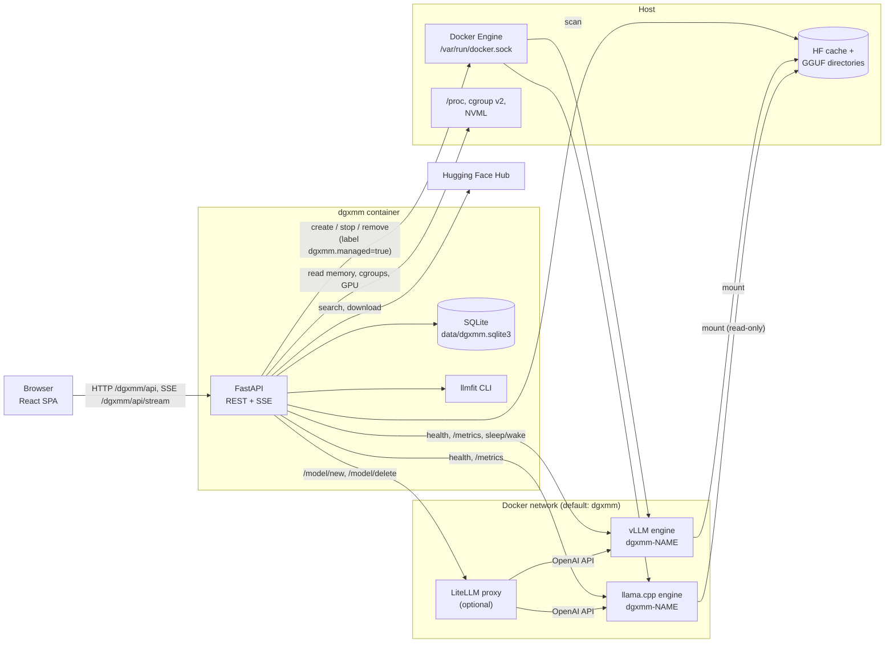
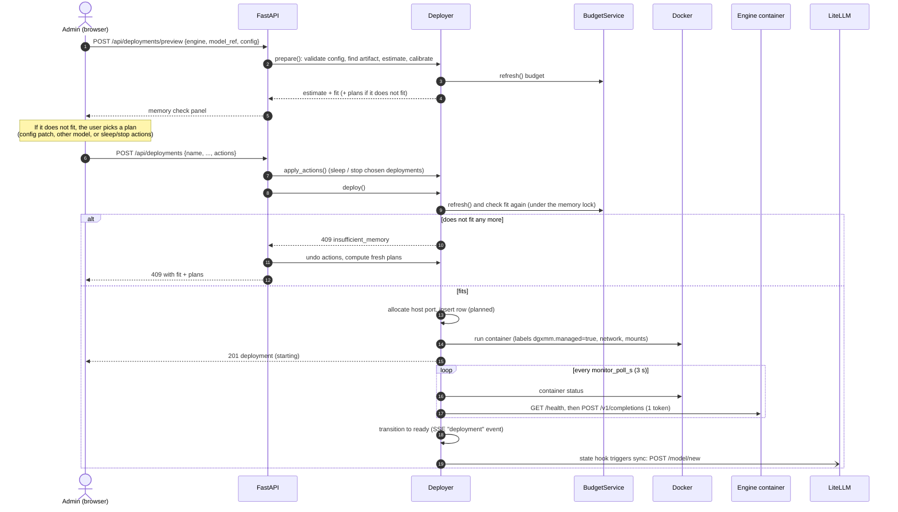
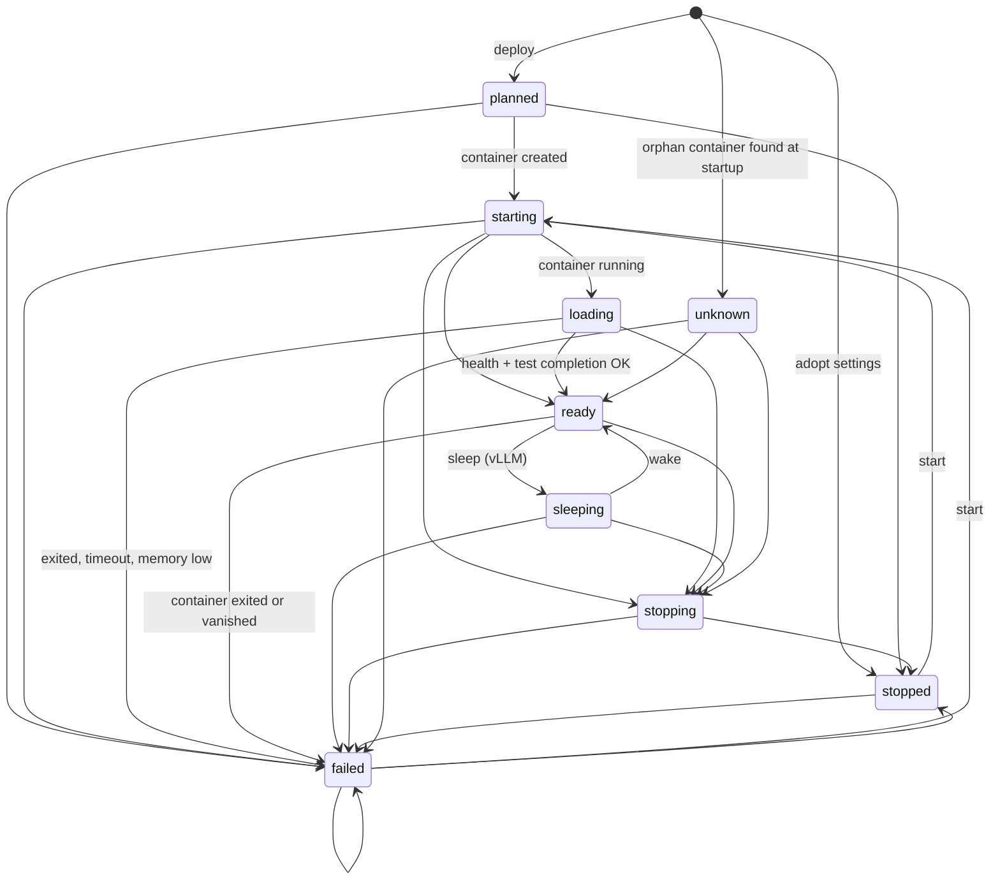

# Architecture

This page explains how DGXMM works inside. You do not need it to use DGXMM. Read it to understand
DGXMM's decisions or to change the code. Each section names the source files it describes.

- [Components](#components)
- [Backend module map](#backend-module-map)
- [Deploying a model, step by step](#deploying-a-model-step-by-step)
- [Memory model](#memory-model)
- [Deployment state machine](#deployment-state-machine)
- [Switch and reconfigure with rollback](#switch-and-reconfigure-with-rollback)
- [Watchdog](#watchdog)
- [Startup and background loops](#startup-and-background-loops)
- [Data model](#data-model)
- [Frontend](#frontend)
- [Security model](#security-model)

## Components

DGXMM is a single container (`dgxmm`). It holds a FastAPI backend, the built React single-page app
and a SQLite database. Everything else it uses is an existing service or a container it starts.



- **Browser.** The UI is served from `/dgxmm/` by the same process. A server-sent event (SSE) stream
  pushes memory, deployment, download, metric and alert updates.
- **FastAPI.** Uvicorn listens on port 8090 in the container (`dgxmm/__main__.py`). All routes live
  under the base path `/dgxmm` (`dgxmm/app.py`), and `/` redirects there.
- **SQLite.** One file, `data/dgxmm.sqlite3`, in WAL mode. The schema is created on start
  (`Base.metadata.create_all`). There are no migrations.
- **Docker API.** DGXMM starts engine containers through the mounted Docker socket. Engines join the
  configured Docker network, where DGXMM reaches them as `http://dgxmm-<name>:<port>`. Their ports are
  also published on the host at `publish_bind` (default `127.0.0.1`).
- **Host probes.** `/proc` and `/sys/fs/cgroup` are mounted read-only. DGXMM reads `/proc/meminfo`, each
  engine container's `memory.stat` (cgroup v2 path `system.slice/docker-<id>.scope`) and per-process
  data. NVML (via the `nvidia` runtime) adds GPU utilisation, temperature, power and per-process GPU
  memory.
- **LiteLLM** (optional). Ready deployments are registered through LiteLLM's model management API, so
  clients can use a single OpenAI-compatible endpoint.
- **Hugging Face Hub.** Catalog search, model details and downloads (with the optional HF token).
- **llmfit.** A Python CLI bundled in the image. It adds fit levels, scores and expected tok/s to
  catalog results. It never decides whether a deploy may proceed.

## Backend module map

| Module | Responsibility |
|---|---|
| `__main__.py` | Entry point: loads settings and runs Uvicorn on `0.0.0.0:8090` with proxy headers enabled. |
| `admin.py` | Admin command line (`python -m dgxmm.admin reset-password` / `list-users`). |
| `app.py` | FastAPI factory: lifespan (startup tasks, background loops), routers, root redirect, SPA fallback. |
| `config.py` | `Settings` model: optional YAML file, then `DGXMM_<KEY>` environment overrides. |
| `context.py` | Wires every service into an `AppContext` and defines the startup and background tasks. |
| `db.py` | SQLAlchemy models and the SQLite engine (WAL, foreign keys, busy timeout). |
| `events.py` | In-process publish/subscribe used by the SSE stream (slow clients drop their oldest events). |
| `audit.py` | Writes audit log rows. |
| `auth/` | `bootstrap` (first admin), `passwords` (argon2id), `sessions`, `ratelimit`, `deps` (auth, CSRF, roles). |
| `api/` | HTTP routers: auth, users, host, inventory, engines, deployments, stream, audit, containers, catalog, downloads, planner, metrics. |
| `deployer/service.py` | Deployment lifecycle: prepare, preview, deploy, monitor, stop, restart, sleep/wake, switch, reconfigure. |
| `deployer/states.py` | Deployment states and allowed transitions. |
| `deployer/reconcile.py` | After a restart: brings the database in line with the containers that actually exist. |
| `deployer/adopt.py` | Copies the settings of an unmanaged vLLM container into a new, stopped deployment. |
| `docker_ctl.py` | The only module that calls Docker. Every write requires the `dgxmm.managed=true` label. |
| `engines/` | Engine plug-ins (`vllm`, `llamacpp`): config schema, container spec, health check, metrics parsing, sleep. `argguard` holds the extra-flag allowlist and `prom` parses Prometheus metrics. |
| `memory/estimate.py`, `kv.py` | Memory estimates per engine (weights, KV cache, state, activations, runtime). |
| `memory/budget.py` | The host memory budget and `free_for_new`. |
| `memory/hostmem.py` | Reads `/proc/meminfo`, container cgroups, external processes and NVML. |
| `memory/calibration.py` | Corrects estimates with measured usage and out-of-memory kills. |
| `planner/fit.py`, `plans.py` | Fit check and "ways to make it fit" plans. |
| `planner/colocate.py` | "What runs together" combinations for the Planner page. |
| `inventory/` | Scans the HF cache and GGUF roots; parses `config.json` and GGUF headers into architecture specs. |
| `catalog/` | Hugging Face search and details (`hub`), llmfit wrapper, vLLM-supported architectures (`support`), fit badges. |
| `downloads.py` | Background Hugging Face downloads with a disk-space guard. |
| `metrics/` | Engine `/metrics` scraper and storage (live ring buffer plus 1-minute rollups). |
| `advisor/` | Tuning rules (`rules`) and the built-in load test (`benchmark`). |
| `watchdog.py` | Memory alerts and optional automatic protection. |
| `litellm.py` | Keeps LiteLLM's model list in sync with ready deployments. |

## Deploying a model, step by step

The deploy wizard calls `preview` repeatedly while you edit the form (with a 350 ms debounce). Only the
final **Deploy** call changes anything.



Details (`dgxmm/deployer/service.py`):

- **prepare** validates the engine config (unknown keys are rejected, and extra flags must be on the
  allowlist). It checks that the model reference is a Hugging Face repo id or a `.gguf` path under an
  allowed root, and that the artifact is fully downloaded and supported by the engine. Then it estimates
  memory and applies calibration.
- **Fit** is `estimate.total <= free_for_new (+ memory the chosen actions free)` (`planner/fit.py`).
- **Container creation** runs under a global memory lock, so two deploys cannot both claim the same
  free memory. vLLM gets `--gpu-memory-utilization = ceil(reservation / MemTotal × 100) / 100`, so its
  memory pool matches the reservation. vLLM containers run with `HF_HUB_OFFLINE=1`: they only use files
  already in the cache.
- **Readiness**: the monitor marks the deployment `loading` once the container runs, and `ready` once
  `/health` returns 200 and a one-token completion succeeds. It fails the deployment if the container
  exits (exit 137 is reported as "likely out of memory" and recorded for calibration), if
  `MemAvailable` falls below the safety margin during startup, or after `startup_timeout_s` (900 s).
  On failure the container is removed and its last 200 log lines are kept in the event history.
- **LiteLLM**: a state hook wakes the sync loop whenever a deployment enters or leaves `ready`.

## Memory model

### Budget

On the GB10, CPU and GPU share one pool of memory, so DGXMM budgets host memory as a whole
(`memory/budget.py`):

```text
usable       = MemTotal − safety_margin_gib − os_reserve_gib            (defaults 8 GiB and 4 GiB)
committed    = Σ max(reserved, measured)  for starting / loading / ready / unknown deployments
             + Σ measured                for sleeping / stopping deployments
external     = max(used − measured_by_managed − ready_gap, 0)           used = MemTotal − MemAvailable
free_for_new = usable − committed − external
```

- *measured* is the engine container's cgroup `anon` + `kernel` memory.
- *external* is everything DGXMM does not manage (desktop, notebooks, other containers). DGXMM never
  touches it. The Dashboard lists the largest external processes (name, pid, RSS and GPU memory, but
  never command lines).
- **GB10 unified memory:** CUDA allocations are not charged to the container's cgroup, so a running
  model's memory shows up in `used` but only partly in *measured*. For `ready` deployments the gap
  between reservation and measurement (`ready_gap`) is credited back, so it does not appear as external
  usage. It is never credited for deployments that are still starting, which keeps the check
  conservative while memory is still growing.

The budget is refreshed every `budget_interval_s` (2 s) and pushed to browsers over SSE.

### Estimates

Each deploy gets an estimate (`memory/estimate.py`). The total is the sum of its parts:

| Part | vLLM | llama.cpp |
|---|---|---|
| weights | size of the safetensors files (plus a speculative draft model's weights) | size of the GGUF file |
| KV cache | from `config.json`: layers, KV heads, head size, KV dtype, attention window, for the KV pool (`kv_tokens`, default `min(context × seqs, 2 × context)`) | from GGUF metadata for `ctx_size` across `parallel` slots, K/V cache types |
| state | recurrent state of SSM and hybrid layers, per sequence | same |
| activations | from batched tokens, hidden and intermediate sizes, and vocabulary | compute buffers from `n_ubatch` |
| runtime | `vllm_runtime_fixed_gib` + `vllm_cuda_graph_gib` (3.0 + 1.5 GiB) | `llamacpp_runtime_fixed_gib` (0.5 GiB) |
| margin | +20 % of KV + state + activations when `config.json` lacks fields the formula needs | same |

The estimate's **confidence** is `low` (fields were missing), `estimated`, `calibrated` or `measured`.

### Calibration

Fifteen seconds after a deployment becomes ready, DGXMM records its measured memory next to the formula
estimate (`memory/calibration.py`). Later estimates for the same model are corrected:

- **Same model and exact same configuration:** `max(measured × 1.05, formula)`. Confidence: `measured`.
- **Same model, other configuration:** the formula is scaled by the mean measured/estimated ratio of
  the last 5 measurements, clamped to 1.0–1.5. Confidence: `calibrated`.
- **Out-of-memory kill (exit 137):** the next estimate for that configuration gets +10 %. It never drops
  back below 1.1 × the size that was killed.

Calibration only raises estimates. It never lowers one below the formula.

### Plans when it does not fit

`planner/plans.py` offers, in this order (options that fit are listed first):

1. a smaller KV cache dtype (vLLM `kv_cache_dtype=fp8`; llama.cpp `q8_0` K and V cache);
2. a shorter context: the largest of context/2, /4, … (at least 4096) that fits;
3. fewer concurrent sequences / slots;
4. a smaller quantization of the same base model that is already on disk;
5. putting lower-priority, sleep-capable vLLM deployments to sleep (frees roughly KV cache and
   activations);
6. stopping deployments, lowest priority first (and largest first within a priority).

Sleep and stop plans run their actions first, then deploy. If the deploy still fails, those actions are
undone.

## Deployment state machine

States and transitions come from `dgxmm/deployer/states.py`. `unknown` is the state of a running managed
container that DGXMM found without a database record (see [reconcile](#startup-and-background-loops)).



Every transition writes a `deployment_events` row (with a log tail on failures) and publishes an SSE
event. A deployment can only be removed when it is `stopped` or `failed`. On every budget refresh, a
liveness check moves `ready`, `sleeping` and `unknown` deployments whose container exited or vanished
to `failed`.

**Sleep** (vLLM only, and only when started with `enable_sleep_mode`, which is the default) calls the
engine's `/sleep?level=1`. That frees the KV cache while the model stays loaded for a fast wake-up.
**Wake** first checks that the memory it will take back is free.

## Switch and reconfigure with rollback

**Switch** (`Deployer.switch`) replaces deployment A with a new deployment B:

1. Estimate B. The memory A frees counts as available. DGXMM sleeps A when that frees enough, and stops
   it otherwise, unless you chose what happens to A yourself. Any other plan actions are added.
2. If it still does not fit, return `409` with fresh plans and change nothing.
3. Apply the actions. Move A's LiteLLM alias to B. Deploy B and wait for `ready` (up to
   `startup_timeout_s` + 30 s).
4. **Rollback** if B does not become ready: stop and remove B, give the alias back to A, and undo every
   action in reverse order (wake what was slept, restart what was stopped). If any undo step fails,
   the error is `rollback_incomplete` and lists what could not be restored.

**Reconfigure** (`Deployer.reconfigure`) changes the configuration (or model) of one deployment in
place. It stops the deployment and restarts it with the new config. If that does not become ready, the
old config is written back and the deployment is restarted with it, then any plan actions are undone.

## Watchdog

`dgxmm/watchdog.py` runs after every budget refresh and looks at `MemAvailable`:

| Level | Condition |
|---|---|
| `ok` | `MemAvailable` ≥ 1.5 × safety margin |
| `warning` | `MemAvailable` < 1.5 × safety margin (12 GiB by default) |
| `critical` | `MemAvailable` < safety margin (8 GiB by default) |

Level changes are logged and sent to the UI as an alert banner. If `auto_protect: true` and the level is
`critical`, the watchdog stops the lowest-priority `ready`, `sleeping` or `unknown` deployment (the
largest reservation goes first within the same priority). It acts at most once every 60 seconds and
audits the stop as `watchdog_stop`. With the default `auto_protect: false` it only warns.

## Startup and background loops

At startup, before the first request is served (`context.py`):

1. **Bootstrap.** If there are no users, create `admin` with a random password and
   `must_change_pw=True`, and log it once.
2. **Recover downloads.** Downloads that were queued or running are marked failed (they do not survive
   a restart).
3. **Inventory.** Scan the HF cache and GGUF roots.
4. **Reconcile** (`deployer/reconcile.py`). Compare the database with the managed containers that
   exist:
   - a missing container marks its deployment `failed`;
   - an exited container is failed with its exit code;
   - a deployment still `starting` or `loading` gets its monitor back;
   - an interrupted `stopping` is finished;
   - a running managed container with no record is recorded as an `unknown` deployment.

   Because DGXMM adopts every container labelled `dgxmm.managed=true`, only one DGXMM instance may run
   per Docker host.

Background loops:

| Loop | Interval | Does |
|---|---|---|
| Budget | `budget_interval_s` (2 s) | Refresh memory, push SSE `budget`, run the watchdog and the liveness check. |
| Metrics scraper | `scrape_interval_s` (5 s) | Scrape each ready engine's `/metrics` and record host samples. Roll up to 1-minute rows every 60 s and drop rollups older than 30 days. |
| Inventory | `inventory_interval_s` (300 s) | Rescan model directories. |
| LiteLLM sync | when a deployment enters or leaves `ready`, else every 60 s | Add missing registrations and remove stale ones. After a failure it retries in 5 s, doubling up to 600 s. |
| vLLM architectures | once | Run a one-off container from the vLLM image to list supported architectures. The result is cached in `data/` per image reference. |
| Deployment monitor | `monitor_poll_s` (3 s), per deployment | Only while starting or loading. |
| Calibration | 15 s after ready | Record measured memory. |

## Data model

SQLite tables (`dgxmm/db.py`):

| Table | Contents |
|---|---|
| `users` | username, argon2id hash, role (`admin` / `viewer`), `must_change_pw` |
| `sessions` | SHA-256 of the session token, user, CSRF token, client IP, expiry |
| `deployments` | name, engine, model reference, validated config, state, container id, port, priority, alias, reservation and estimate, LiteLLM status, last error and exit code |
| `deployment_events` | state transitions with message and optional log tail |
| `memory_calibration` | estimated vs measured bytes per engine, model and config hash; OOM records |
| `benchmarks` | one row per concurrency level: TTFT p50/p95, ITL p50, total and per-request tok/s |
| `metric_rollups` | 1-minute aggregates per deployment and for the host (30-day retention) |
| `downloads` | repo, revision, files, progress, state, error |
| `favourites` | model references starred in the Planner |
| `audit_log` | user, action, target, details, timestamp |

Live metrics (about the last hour at the scrape interval) are kept in memory only.

## Frontend

`frontend/` is a React 18 + TypeScript app built with Vite (`base: /dgxmm/`, router basename
`/dgxmm`). The Docker image builds it and serves it from `/app/static`.

- **Pages** (`src/pages/`): Login, Change password, Dashboard, Deployments, Deployment detail, Deploy
  wizard, Models (on disk), Catalog, Downloads, Planner, Users, Audit log. Catalog, Planner, Deployment
  detail and Audit are lazy-loaded.
- **Design system** (`src/components/ui/`): shadcn/ui components on Radix primitives, styled with
  Tailwind CSS tokens. There is a light theme and a dark theme. Status is always shown as icon plus
  text, and Inter and JetBrains Mono fonts are self-hosted. App building blocks (shell, sidebar, data
  tables, memory bar, plan chooser, command palette) live in `src/components/app/`.
- **Data**: TanStack Query for every API call (`src/api.ts` adds the CSRF header). `src/stream.ts`
  opens one `EventSource` on `/dgxmm/api/stream`: `budget` events update the host data in place,
  `metrics` events are appended to the live chart series, and `deployment`, `download` and `inventory`
  events refresh the matching queries.
- **Charts**: Recharts with a fixed palette that has light and dark variants.

## Security model

- **Authentication** (`auth/`): username and password with argon2id hashes. New passwords need at
  least 12 characters. For unknown users, login still verifies a dummy hash, so response timing does not reveal which usernames exist. Failed and rate-limited
  logins are audited.
- **Sessions**: a random token in an HTTP-only, `SameSite=Strict` cookie `dgxmm_session` scoped to
  `/dgxmm`. Only its SHA-256 is stored. Sessions expire after `session_ttl_s` (12 h) of inactivity
  (the expiry slides on each request). The cookie is `Secure` when the request arrived over HTTPS
  (`secure_cookies: auto`). Changing a password signs out the user's other sessions. An admin reset
  signs out all of them.
- **CSRF**: every non-GET request must send the session's token in `X-CSRF-Token`.
- **Rate limiting**: 5 login attempts per 60 seconds, per client IP and per username.
- **First login**: users created by bootstrap, by an admin or by a reset must change their password
  before any other API call.
- **Roles**: `viewer` has read-only access. Viewers can see deployments, models, metrics, the catalog
  and the planner, and can run memory previews. They cannot see container logs, the audit log or the
  adoptable-container list, and the UI hides the admin pages. `admin` is needed for every change. The
  last admin cannot be deleted or demoted.
- **Audit**: logins (also failed and rate-limited ones), password changes, deploy, start, stop, remove,
  sleep, wake, switch and reconfigure (plus their failures), adopt, downloads and cancellations,
  inventory rescans, benchmarks, user changes, watchdog stops and command-line password resets are
  written to `audit_log`.
- **Container guard**: `docker_ctl.py` refuses to create a container without `dgxmm.managed=true` and
  to stop or remove one that lacks it. Containers it does not manage are only ever read.
- **Engine arguments**: configs are strict schemas, and extra CLI flags must match a per-engine
  allowlist (`engines/argguard.py`). Flags DGXMM controls (`--model`, `--port`, `--host`,
  `--gpu-memory-utilization`, …) cannot be overridden. Model references must be a repo id or a `.gguf`
  file under a configured root.
- **Trust boundary**: the Docker socket gives DGXMM root-equivalent control of the host. Only give the
  admin role to people you would trust with root, and keep the UI off the public internet (see
  [operations](operations.md#security-hardening)).
