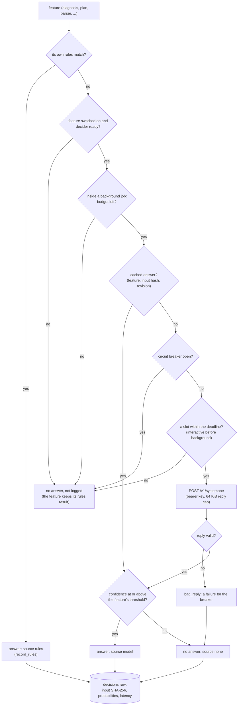

# Decision model

## Decision model (decider)

The decision model is optional and advisory. Its code is in `dgxmm/decider/` and
`dgxmm/engines/decision.py`, its image in `deploy/decider/`. The threat model, with every control and
what was measured, is in [security.md](../security.md#decision-model-decider); accuracy and capacity are in
[decider-evaluation.md](../decider-evaluation.md).

**Deployment.** The decider is a deployment of the `decision` engine named `decider`, created by
`POST /api/decider/enable` through the normal deploy path (fit check, plans, start-up gate) with a fixed
model (`decider.model`: d3-mini or d3-nano) and a fixed, measured reservation (13 or 9 GiB, never
calibrated). Its row has `system = true`: plans never stop or sleep it, LiteLLM sync skips it, the UI
shows a **System** badge, and the watchdog stops it before any user deployment (see
[watchdog](deployer.md#watchdog)). Disabling stops it; `{"remove": true}` also deletes the row.

**Container** (`DecisionEngine.container_spec`, `DockerController.run`). Built locally as
`images.decision` (`dgxmm-decider:3`) from a digest-pinned vLLM base with hash-pinned wheels, by
`dgxmm/decider/image.py` (the **Build image** button, progress on the admin-only SSE topic `decider`)
or `admin decider build`. It runs as `decider_user` (10001), with a read-only root filesystem, every
capability dropped, `no-new-privileges`, private IPC, `decider_pids_limit`, a cgroup memory limit
(`decider_memory_limit_gib`), `/tmp` as a `decider_tmp_gib` tmpfs and `restart: no`. The only mounts
are the selected model's repo directory of the HF cache, read-only, plus one read-only bind per
shared-store blob that its snapshot links to. At start the launcher copies the pinned files into a
private directory on its tmpfs, checks each copy against the image's hash list and refuses to start
(exit 3) on a mismatch; exit 2 means the snapshot is missing, exit 4 that no key arrived.

**Network.** The decider joins only `decider_network` (`dgxmm-decider`), an internal Docker network
that DGXMM creates on the first start and then attaches its own container to (again at every DGXMM
start, so an upgraded container rejoins). It publishes no port. DGXMM reaches it as
`http://dgxmm-decider:<port>`. The network's subnets are read at start and every 30 s, and forwarding
headers from them are always ignored (`proxy_headers.py`).

**Key.** A bearer key is generated once in `data/secrets/decider_api_key` (mode 600). Right after the
container starts, DGXMM writes it through `docker exec` stdin into a 0400 file on the container's
tmpfs (`/run/dgxmm-decider/api_key`); the launcher reads and deletes it and hands it to the server, so
it is never in the environment, the command line or `docker inspect`. If the write fails the
container is removed at once. Rotation (`dgxmm/decider/rotation.py`, `POST /api/decider/rotate-key`
or the CLI through a request file the app watches) stops the decider, writes a new key with an atomic
rename and starts it again.

**Asking a question** (`Decider.decide`, `SystemOneClient`). A feature sends a fixed question, a set of
options (at most 128) and a *state*: facts DGXMM assembled, with untrusted text (log lines, chat
template, model name, `config.json`) quoted in labelled blocks, length-capped and redacted. The client:

1. answers at once with *no answer* when the feature is switched off, the decider is not `ready`, or the
   circuit breaker is open (3 failures in a row open it for 60 s; a good supervisor probe closes it);
2. queues behind at most `decider_max_in_flight` (2) questions at the server, interactive ones (plan,
   parser, the wizard and ⌘K features) ahead of background ones (diagnosis, kind, workload, the background
   jobs, which also hold at most one of the two slots), and gives up (*busy*, answered by
   rules, not counted as a failure) after `decider_queue_timeout_s` (1 s; background: half the deadline)
   or when the remaining deadline is shorter than the measured service time;
3. posts to `/v1/systemone` with the bearer key, reads at most 64 KiB of the reply, and validates it:
   finite probabilities in [0, 1] for offered options only, summing to about 1, and the choice is the
   most probable option. Anything else is a `bad_reply` failure;
4. returns the choice with its confidence. The feature uses it only at or above its threshold
   (`decider.feature.<f>.threshold`); below it the decision is logged as abstained.

Each question, answered or not, is a `decisions` row with the input's SHA-256 (never the state text),
probabilities, latency and model revision; answers are cached in memory by feature, input hash and
model revision (256 entries).

The whole path of one question, from the feature's rules to the logged decision (`Decider.decide` in
`dgxmm/decider/service.py`, `SystemOneClient.choose` in `dgxmm/decider/client.py`):

A switched-off feature, a decider that is not ready, a used-up job budget, an open breaker and a busy
client are not logged (busy and unavailable calls only show in the load counters of `GET /api/decider/status`),
so a burst cannot flood the log; every
answer the model gave, also below the threshold, and every failed request is a `decisions` row.

**Rules first.** Each feature runs its own deterministic rules before it asks anything, in worker
threads and with bounded regexes over capped input:

| Feature | Rules | Model asked | Effect |
|---|---|---|---|
| Diagnosis (`diagnosis.py`) | 14 causes from log patterns, Docker's OOM flag and the decider's own exit codes, on a failed deployment's stored log tail | when no rule matched (10 s, background) | a `diagnoses` row (cause, fix hint, validated patch, redacted excerpt), SSE `diagnosis` |
| Parser (`config_suggest.py`) | chat-template evidence (strong) and model-family names (weak) | when no rule matched (4 s per question) | wizard suggestion; auto-fill only for strong rules or model ≥ threshold |
| Plan (`plans.py`) | safety filter: `unsafe_reason` per plan; exactly one safe plan is recommended by rules | two or more safe plans (2 s, cached 2 min) | `recommended`, `recommendation` on the plan |
| Kind (`kind.py`) | scanner rules (`inventory/kinds.py`) | models no rule recognises, once per snapshot (background loop) | `artifact_kinds` cache, `kind_source` / `kind_confidence` |
| Workload (`workload.py`) | idle and saturated-batch patterns from the last hour of rollups (≥ 30 minutes needed) | otherwise (2 s, cached 15 min) | advice `relevance` and `workload_fit` |

Rules decisions are logged too (source `rules`). Nothing the decider answers runs anything: diagnoses
and suggestions only prefill dialogs, plans are still chosen and applied by the admin. The table lists the
first five features; the other eleven follow the same pattern and are described in
[advanced decision-model features](#advanced-decision-model-features).

**Supervisor** (`supervisor.py`). Every `decider_probe_interval_s` (30 s) while enabled it probes a ready
decider (`/health` plus one question). `decider_hang_probes` (3) failures in a row while the container
runs, or a failed deployment, lead to a restart through the normal deployer path, with backoff
(`decider_restart_backoff_s` doubling to `decider_restart_backoff_max_s`, reset after `decider_stable_s`),
at most `decider_max_restarts_per_hour` attempts (failed ones included), never under memory pressure, never during a key rotation and
never after an admin stopped it. A watchdog stop counts as a failure. After a model switch it rolls back
to the previous model if the new one fails to start. Status, breaker, load and supervisor state are in
`GET /api/decider/status`.

**Retention** (`retention.py`). Once a minute, with the metrics rollups, `decisions` rows older than
`decider_retention_days` (30) or beyond the newest `decider_max_rows` (50 000) are deleted, except rows with
feedback, which are kept for `decider_feedback_retention_days` (180); `diagnoses` keep the latest 20 per
deployment (they are also deleted with their deployment), and `compat_cache` rows are deleted after 7 days.

## Advanced decision-model features

Eleven of the sixteen features add proactive findings, background work and user-owned automation on top of
the question path above. Using them: [usage](../user-guide/insights.md); controls and residual risks:
[security](../security.md#background-job-engine).

### Feature registry

`dgxmm/decider/registry.py` declares every feature once: `FeatureSpec(name, group, label, description,
default_threshold, background, needs_model, viewer_visible, rate_limit)`. The registry drives the
settings keys (`decider.feature.<group>.enabled|threshold`), the switches and thresholds on the Decision
model page (`feature_specs` in `GET /api/decider/status`), the client priority (`background` features use
the decider client's background lane), the per-feature rate-limit buckets (`decider_<name>`, 30 per user
and 120 for all users per minute unless the spec says otherwise) and the evaluation harness
(`tools/eval_feature.py`). `parser_tool` and `parser_reasoning` are members of the `parser` group and
share its switch and threshold. A feature with `needs_model=False` (`tuning`) never asks the decider.

### Deploy-time advice, compatibility fetch and the code scanner

Routes in `dgxmm/api/deploy_advice.py`. Config advice (`config.py`) builds a grid of sizings, sizes each
with the deployer's memory calculator, keeps those that fit and cuts them to at most eight Pareto-optimal
options before the model ranks them. Draft pairing (`draft.py`) and engine choice (`engine.py`) are rules
over the inventory with a model question only for ties.

The **compatibility check** (`compat.py`) runs its Hub calls on a 2-thread pool of its own. It reads repo
metadata (anonymously for viewers), then at most five allow-listed small files through
`HfHubClient.fetch_small` (64 KiB each, 5 s per file, redirects only to Hub hosts), never touching the HF
cache. Rules map the architecture against the pinned vLLM image's list, GGUF files to llama.cpp,
`auto_map` to trust_remote_code, gating to an HF token. Results by `(repo, commit sha)` go to
`compat_cache` (verdicts and reason keys only, 7 days; private, gated and access-dependent results are
not cached).

The **remote-code check** (`remote_code.py`) runs `python -I -S code_scan.py` as a subprocess with an
empty environment, `cwd=/`, its own session and its own resource limits (CPU 20 s, 1 GiB address space,
no file writes, no core dumps) under a 30 s timeout, at most one at a time. The scanner parses the
snapshot's `.py` files with `ast` and returns findings (file, line, kind); a repo-wide failure is
retried one file per process. The model only sees a summary and quoted excerpts and can only add an
"unusual" warning.

### ⌘K commands

`dgxmm/decider/command.py` and `dgxmm/api/commands.py`. `prepare()` runs in a worker thread: it refuses
destructive requests (after Unicode normalisation and lookalike folding), extracts numbers and model refs
with rules, and fuzzy-matches the text against the user's own targets (pages, deployments, models; at most
60 words and 400 targets scored, 20 offered). Then the model is asked for the action and the target among
those options (3 s per question, 8 s overall; on the deadline the rules result is returned). The answer is
a list of interpretations with templated labels; the client opens the normal dialog for the one chosen.
`POST /api/decider/free-memory` re-computes the plan on the server and applies it through the deploy-plan
path.

## Next steps

- [Insights and the job engine](insights-jobs.md)
- [Threat model](../security.md)
- [Evaluation](../decider-evaluation.md)
