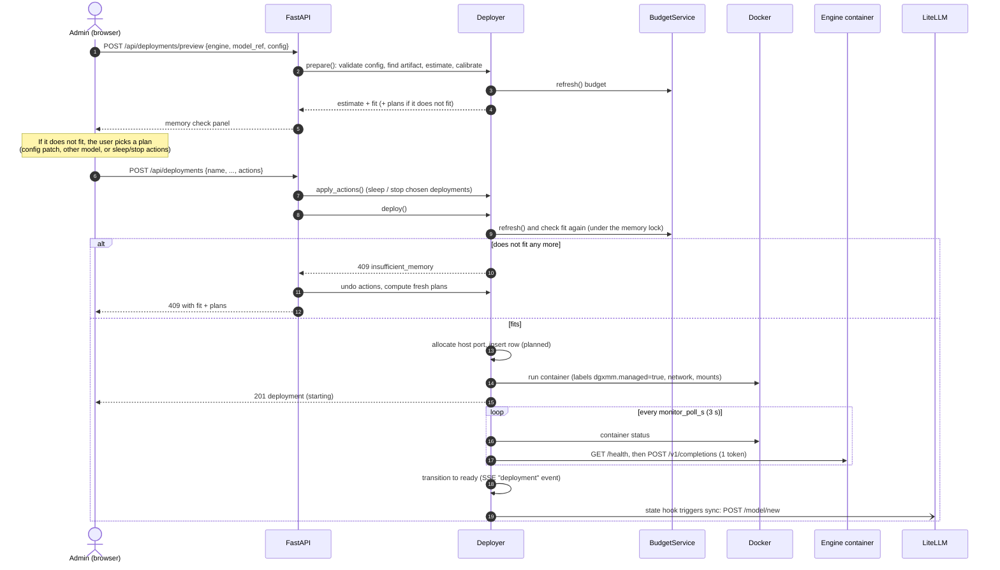
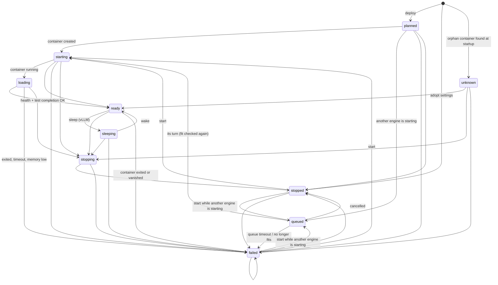

# Deployer and start-up gate

## Deploying a model, step by step

The deploy wizard calls `preview` repeatedly while you edit the form (with a 350 ms debounce). Only the
final **Deploy** call changes anything.

Details (`dgxmm/deployer/service.py`):

- **prepare** validates the engine config (unknown keys are rejected, and extra flags must be on the
  allowlist). It checks that the model reference is a Hugging Face repo id or a `.gguf` path under an
  allowed root, and that the artifact is fully downloaded and supported by the engine. Then it estimates
  memory and applies calibration.
- **Fit** is `estimate.total <= free_for_new (+ memory the chosen actions free)` (`planner/fit.py`).
- **Container creation** runs under a global memory lock, so two deploys cannot both claim the same
  free memory. vLLM gets `--gpu-memory-utilization = ceil(reservation / MemTotal × 100) / 100`, so its
  memory pool matches the reservation. vLLM containers run with `HF_HUB_OFFLINE=1`: they only use files
  already in the cache.
- **Readiness**: the monitor marks the deployment `loading` once the container runs, and `ready` once
  `/health` returns 200 and a one-token completion succeeds. It fails the deployment if the container
  exits (it is reported as out of memory, and recorded for calibration, only with evidence: Docker's
  `OOMKilled`, or the kernel OOM killer's own line in the log; a plain exit 137 is reported as a SIGKILL,
  e.g. `docker kill` or a stop timeout, and never recorded), if
  `MemAvailable` falls below the safety margin during startup, or after `startup_timeout_s` (900 s).
  On failure the container is removed and its last 200 log lines are kept in the event history.
- **Start-up gate** (`deployer/gate.py`): at most `max_concurrent_startups` (default 1) engines are
  `starting`/`loading` at once. vLLM sizes its KV cache from a memory profile taken while it starts and
  asserts that free memory did not change meanwhile; on unified memory another engine starting, waking
  or stopping changes it ("Error in memory profiling", "No available memory for the cache blocks").
  A deploy/start that finds the slot taken passes the fit check, keeps its reservation and port, and
  waits in state `queued` (FIFO) with a reason (`startup_queue` in the deployment view: position, what it
  waits for). When its turn comes the fit is checked again (memory outside DGXMM may have grown);
  it fails with a clear message if it no longer fits or after `startup_queue_timeout_s` (1800 s).
  Stopping a queued deployment cancels it. A wake-up (which re-allocates the KV cache) waits for the
  slot too: the request waits up to `wake_sync_wait_s` (50 s), then answers 202 (`startup_queue` set) while the
  wake-up continues in the background, up to `wake_queue_timeout_s` (300 s). Time spent queued
  does not count against switch/reconfigure waits. After a DGXMM restart, deployments still starting
  hold their slots and queued ones re-enter the queue. Stops and sleeps are never delayed (freeing
  memory must stay immediate), so a stop during another engine's start-up can still disturb it.
- **LiteLLM**: a state hook wakes the sync loop whenever a deployment enters or leaves `ready`.

## Deployment state machine

States and transitions come from `dgxmm/deployer/states.py`. `unknown` is the state of a running managed
container that DGXMM found without a database record (see [reconcile](background-loops.md)).

Every transition writes a `deployment_events` row (with a log tail on failures) and publishes an SSE
event. A deployment can only be removed when it is `stopped` or `failed`. On every budget refresh, a
liveness check moves `ready`, `sleeping` and `unknown` deployments whose container exited or vanished
to `failed`.

**Sleep** (vLLM only, and only when started with `enable_sleep_mode`, which is the default) calls the
engine's `/sleep?level=1`. That frees the KV cache while the model stays loaded for a fast wake-up.
**Wake** first checks that the memory it will take back is free.

## Switch and reconfigure with rollback

**Switch** (`Deployer.switch`) replaces deployment A with a new deployment B:

1. Estimate B. The memory A frees counts as available. DGXMM sleeps A when that frees enough, and stops
   it otherwise, unless you chose what happens to A yourself. Any other plan actions are added.
2. If it still does not fit, return `409` with fresh plans and change nothing.
3. Apply the actions. Move A's LiteLLM model name (its alias) to B. Deploy B and wait for `ready` (up to
   `startup_timeout_s` + 30 s).
4. **Rollback** if B does not become ready: stop and remove B, give the alias back to A, and undo every
   action in reverse order (wake what was slept, restart what was stopped). If any undo step fails,
   the error is `rollback_incomplete` and lists what could not be restored.

**Reconfigure** (`Deployer.reconfigure`) changes the configuration (or model) of one deployment in
place. It stops the deployment and restarts it with the new config. If that does not become ready, the
old config is written back and the deployment is restarted with it, then any plan actions are undone.

## Watchdog

`dgxmm/watchdog.py` runs after every budget refresh and looks at `MemAvailable`:

| Level | Condition |
|---|---|
| `ok` | `MemAvailable` ≥ 1.5 × safety margin |
| `warning` | `MemAvailable` < 1.5 × safety margin (12 GiB by default) |
| `critical` | `MemAvailable` < safety margin (8 GiB by default) |

Level changes are logged and sent to the UI as an alert banner. If `auto_protect: true` and the level is
`critical`, the watchdog stops the lowest-priority `ready`, `sleeping` or `unknown` deployment (the
largest reservation goes first within the same priority). It acts at most once every 60 seconds and
audits the stop as `watchdog_stop`. With the default `auto_protect: false` it only warns.

System deployments are never stopped, except the decision model: it is advisory and fails open, so it is
sacrificed before any user deployment. It is the first victim of `auto_protect`, and, whatever `auto_protect`
says, the watchdog stops it when its measured memory exceeds its reservation by more than
`decider_overuse_margin_gib` in two samples in a row (its GPU memory is not capped by its cgroup). The stop is a
deployment event and a `watchdog_stop` audit entry; `/api/decider/status` shows it as the supervisor's
`last_action: watchdog_stopped` with the reason, and the supervisor restarts it after its backoff, never while
memory is under pressure.

## Next steps

- [Memory budget and fit planner](memory.md)
- [Startup and background loops](background-loops.md)
