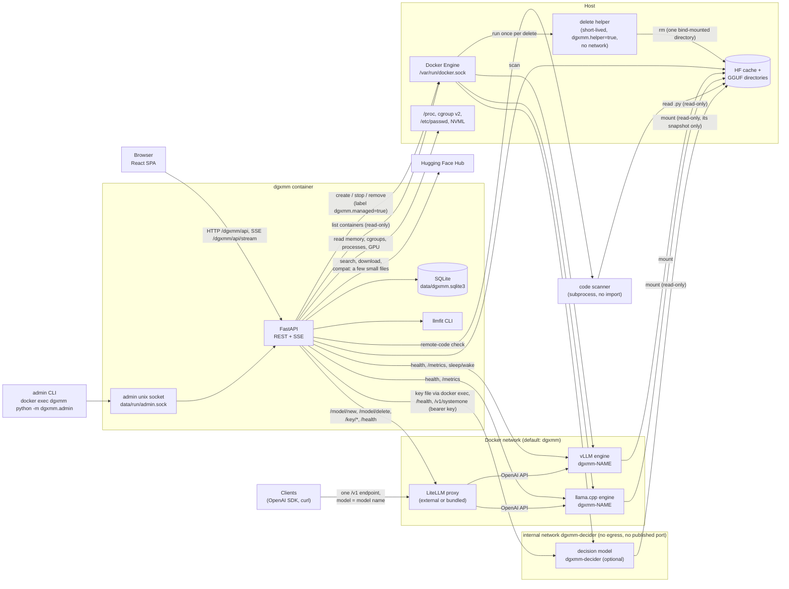

# Architecture overview

This page explains how DGXMM works inside. You do not need it to use DGXMM. Read it to understand
DGXMM's decisions or to change the code. Each section names the source files it describes.

## Components

DGXMM is a single container (`dgxmm`). It holds a FastAPI backend, the built React single-page app
and a SQLite database. Everything else it uses is an existing service or a container it starts,
including the optional decision model (`dgxmm-decider`) on its own internal network.

- **Browser.** The UI is served from `/dgxmm/` by the same process. A server-sent event (SSE) stream
  pushes memory, deployment, download, metric and alert updates.
- **FastAPI.** Uvicorn listens on port 8090 in the container (`dgxmm/__main__.py`). All routes live
  under the base path `/dgxmm` (`dgxmm/app.py`), and `/` redirects there.
- **SQLite.** One file, `data/dgxmm.sqlite3`, in WAL mode. On start, new tables are created
  (`Base.metadata.create_all`), missing nullable columns and non-unique indexes are added, and then the
  versioned migrations in `dgxmm/migrations.py` run once each, in a transaction, recorded in
  `schema_version` (see [operations](../getting-started/upgrade.md#upgrading-an-existing-install)). It also holds the
  runtime settings (`app_settings`) that the UI can change.
- **Docker API.** DGXMM starts engine containers through the mounted Docker socket. Engines join the
  configured Docker network, where DGXMM reaches them as `http://dgxmm-<name>:<port>`. Their ports are
  also published on the host at `publish_bind` (default `127.0.0.1`).
- **Host probes.** `/proc`, `/sys/fs/cgroup` and `/etc/passwd` are mounted read-only. DGXMM reads
  `/proc/meminfo`, each engine container's `memory.stat` (cgroup v2 path `system.slice/docker-<id>.scope`)
  and per-process data (see [process view](processes.md)). NVML (via the `nvidia` runtime) adds GPU
  utilisation, temperature, power and per-process GPU memory.
- **Delete helper.** To delete model files that engine containers left owned by root, DGXMM starts a
  short-lived, locked-down container that runs `rm` on one bind-mounted directory (see
  [deleting weights](storage.md#deleting-weights)).
- **LiteLLM** (optional; an existing proxy or the bundled one). Each ready deployment is registered once
  through LiteLLM's model management API, so clients use a single OpenAI-compatible endpoint. DGXMM
  also proxies LiteLLM's virtual-key API for the UI (see [LiteLLM integration](litellm.md)).
- **Hugging Face Hub.** Catalog search, model details and downloads (with the optional HF token), and the
  compatibility check's bounded reads of a few small files per repo.
- **Code scanner.** A short-lived Python subprocess (`dgxmm/decider/code_scan.py`, standard library only,
  resource-limited) that parses a snapshot's `.py` files with `ast` for the remote-code check. It never
  imports or runs them.
- **llmfit.** A Python CLI bundled in the image. It adds fit levels, scores and expected tok/s to
  catalog results. It never decides whether a deploy may proceed.
- **Decision model** (optional). A small classifier served from a locally built, hardened image on an
  internal network. DGXMM asks it typed questions with a fixed set of answers and uses its answer only
  above a confidence threshold, after its own rules (see [decision model](decision-model.md#decision-model-decider)).
- **Admin unix socket.** A second listener on `data/run/admin.sock` (mode 0600 in a 0700 directory) for
  the admin CLI (`docker exec dgxmm python -m dgxmm.admin decider …`). Short-lived CLI tokens are only
  accepted there, never on the TCP port.

## Backend module map

| Module | Responsibility |
|---|---|
| `__main__.py` | Entry point: loads settings and runs Uvicorn on `0.0.0.0:8090` with proxy headers enabled. |
| `admin.py` | Admin command line (`python -m dgxmm.admin`): `reset-password`, `list-users`, `reset-calibration`, `decider …`, `rotate-decider-key`. |
| `admin_listener.py` | The admin unix socket next to the TCP listener (`DualServer`), without proxy-header handling. |
| `proxy_headers.py` | Applies `X-Forwarded-For` / `-Proto` only from `trusted_proxies`, and never from the decider's network. |
| `lifecycle.py` | Shutdown signal shared by the SSE streams and background loops, so `docker stop` ends cleanly. |
| `migrations.py` | Versioned, run-once schema migrations (`schema_version`) and automatic non-unique indexes. |
| `app.py` | FastAPI factory: lifespan (startup tasks, background loops), routers, root redirect, SPA fallback. |
| `config.py` | `Settings` model: optional YAML file, then `DGXMM_<KEY>` environment overrides. |
| `context.py` | Wires every service into an `AppContext` and defines the startup and background tasks. |
| `db.py` | SQLAlchemy models and the SQLite engine (WAL, foreign keys, busy timeout), plus `add_missing_columns`. |
| `events.py` | In-process publish/subscribe used by the SSE stream (slow clients drop their oldest events). |
| `audit.py` | Writes audit log rows. |
| `auth/` | `bootstrap` (first admin), `passwords` (argon2id), `sessions`, `ratelimit`, `deps` (auth, CSRF, roles). |
| `settings_store.py` | Runtime settings in the `app_settings` table, with a cache and typed accessors (LiteLLM URLs, master key and its URL binding, enabled). |
| `api/` | HTTP routers: auth, users, host (incl. processes), inventory (incl. delete and clean-up), engines, deployments, integrations (LiteLLM), stream, audit, containers, catalog, downloads, planner, metrics, decider (status, settings, enable/disable, image, decisions, key rotation), decider features (diagnosis, workload, suggest-config), `insights`, `deploy_advice` (compat, config, draft, engine, remote-code), `decider_ops` (routing advice), `schedules` and `commands` (⌘K, free memory). `ratelimit.py` holds the per-user API rate limits, with the per-feature buckets taken from the feature registry. |
| `deployer/service.py` | Deployment lifecycle: prepare, preview, deploy, monitor, stop, restart, sleep/wake, switch, reconfigure. |
| `deployer/states.py` | Deployment states and allowed transitions. |
| `deployer/reconcile.py` | After a restart: brings the database in line with the containers that actually exist. |
| `deployer/adopt.py` | Copies the settings of an unmanaged vLLM container into a new, stopped deployment. |
| `deployer/gate.py` | The start-up gate: at most `max_concurrent_startups` engines starting or loading, the others `queued` (FIFO). |
| `deployer/logtail.py` | The log tail stored with a failure: line cap, error lines from the cut part, redaction, OOM evidence. |
| `docker_ctl.py` | The only module that calls Docker. Every write requires the `dgxmm.managed=true` label, except the delete helpers it creates itself (`dgxmm.helper=true`). Also holds the read-only, cached container directory (id → name, image, deployment). |
| `engines/` | Engine plug-ins (`vllm`, `llamacpp`, `decision`): config schema, container spec, health check, metrics parsing, sleep. `decision.py` holds the supported decision models (pinned revisions, fixed reservations) and the hardened decider container spec. `argguard` holds the extra-flag allowlist and `prom` parses Prometheus metrics. |
| `memory/estimate.py`, `kv.py` | Memory estimates per engine (weights, KV cache, state, activations, runtime). |
| `memory/budget.py` | The host memory budget and `free_for_new`. |
| `memory/hostmem.py` | Reads `/proc/meminfo`, container cgroups, processes (with container, user and command) and NVML. |
| `memory/redact.py` | Masks secrets in process command lines before they leave the probe. |
| `memory/calibration.py` | Corrects estimates with measured usage and out-of-memory kills. |
| `planner/fit.py`, `plans.py` | Fit check and "ways to make it fit" plans. |
| `planner/colocate.py` | "What runs together" combinations for the Planner page. |
| `inventory/` | Scans the HF cache and GGUF roots; parses `config.json` and GGUF headers into architecture specs. `weights.py` plans and performs weight deletion and incomplete clean-up. |
| `catalog/` | Hugging Face search and details (`hub`), llmfit wrapper, vLLM-supported architectures (`support`), fit badges. |
| `downloads.py` | Background Hugging Face downloads with a disk-space guard. |
| `metrics/` | Engine `/metrics` scraper and storage (live ring buffer plus 1-minute rollups). |
| `advisor/` | Tuning rules (`rules`) and the built-in load test (`benchmark`). |
| `watchdog.py` | Memory alerts and optional automatic protection. |
| `decider/` | The decision model: `service.py` (the `Decider`: settings, thresholds, decision log), `client.py` (`SystemOneClient`: back-pressure, circuit breaker, answer validation), `supervisor.py` (probes and restarts), `image.py` (in-app image build), `snapshot.py` (verified snapshot download), `secret.py` / `rotation.py` (bearer key), `upgrade.py` (detects a decider from an older build), `retention.py`, `cli.py` (`admin decider …`), `registry.py` (the feature registry), `insights.py` (insights feed), `insight_engine.py` (background jobs), `features.py` / `operations.py` (wiring), and one module per feature: `diagnosis.py`, `config_suggest.py`, `plans.py`, `kind.py`, `workload.py`, `health.py`, `config.py`, `compat.py`, `draft.py`, `engine.py`, `command.py`, `schedule.py`, `reading.py`, `tuning.py`, `routing.py`, `remote_code.py` (with the scanner `code_scan.py`). |
| `litellm.py` | LiteLLM client (URL and key resolved per call, errors scrubbed of keys, cached status) and the sync that keeps LiteLLM's model list in line with ready deployments. |

## Next steps

- [Request and data flow](request-flow.md)
- [Memory budget and fit planner](memory.md)
- [Deployer and start-up gate](deployer.md)
