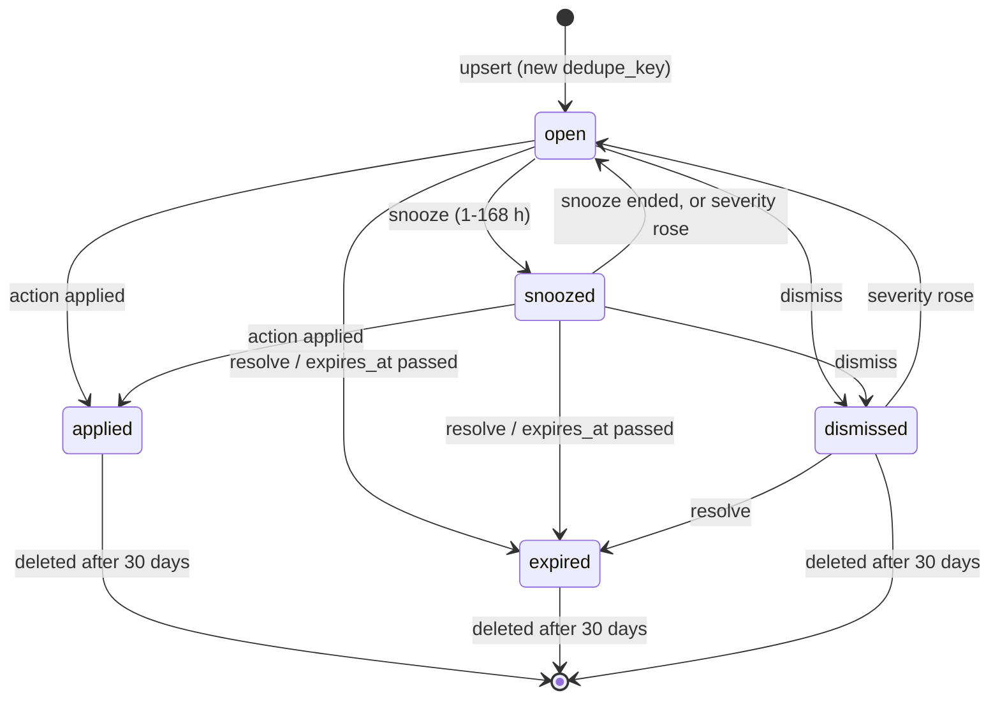

# Insights and the job engine

## Insights feed

`dgxmm/decider/insights.py` (`InsightService`, table `insights`) stores proactive findings. Every insight
has a kind, the feature, a subject (`deployment:<id>`, `litellm`, `feature:<group>`, `job:<name>`), a
severity, a templated title and body, the source and confidence, the id of the decision behind it, an
optional action descriptor and a status (`open`, `snoozed`, `dismissed`, `applied`, `expired`).

- A partial unique index allows one live insight per `dedupe_key`: a producer calls `upsert` on every
  check and the row is updated in place; `resolve` closes it (optionally after a grace period).
- Action descriptors (`reconfigure`, `schedule`, `threshold`, `copy`, `open`) are validated on write
  (pydantic models; `reconfigure` patches may not touch `model_ref` or `trust_remote_code`). The server
  never executes one: the UI turns it into the existing dialog, which calls the normal endpoint, and then
  marks the insight applied.
- `GET /api/insights` filters by role: viewers get the features with `viewer_visible`, without actions.
  The SSE topic `insights` carries only ids; the UI refetches.
- Retention runs with the metrics rollups: snoozes that ended reopen, `expires_at` closes proposals
  (7 days) and degraded notices, and closed insights are deleted after 30 days. A deployment's insights
  are deleted with it.

### Insight lifecycle

Statuses and transitions from `dgxmm/decider/insights.py`. `open`, `snoozed` and `dismissed` are *live*
(`INSIGHT_LIVE` in `dgxmm/db.py`): a producer's `upsert` with the same `dedupe_key` updates that row
instead of creating a new one.

- An `upsert` on a dismissed insight with the same or a lower severity only refreshes its timestamp, so
  a dismissed finding does not come back while its condition lasts.
- `resolve` with a grace period (health insights: 1 hour) keeps the insight open until the grace ends,
  and a later `upsert` cancels it.
- `applied` and `expired` are final; a new finding for the same key creates a new row.

## Background job engine

`dgxmm/decider/insight_engine.py` (`InsightEngine`) runs the periodic jobs of the features. Features
register jobs in `wire_features` / `wire_operations` / `wire_schedules`:

| Job | Cadence | Model budget per run | Produces |
|---|---|---|---|
| `health_check` | every 300 s | 8 | health insights with a reconfigure action |
| `reading_labels` | on each new reading, every 900 s as a sweep | 8 | `reading` / `quality` on benchmark and calibration rows; a broken-reading insight |
| `traffic_profiles` | daily 03:10 | 0 | `traffic_profiles` rows |
| `schedule_proposals` | daily 03:40 | 24 | schedule-proposal insights |
| `schedule_runner` | every 60 s | 0 | schedule runs (deployer calls), failure insights |
| `routing_advice` | daily 05:15, and 15 s after change notices (at most 60 s) | 6 | routing advice (LiteLLM page) and its insight |
| `threshold_tuning` | weekly, Sunday 04:30 | 0 (rules only) | threshold-proposal insights |

- **One scheduler**, ticking every 5 s; `trigger(name)` wakes it at once, and `trigger(name, settle_s)`
  coalesces a burst of change notices into one run. Daily and weekly times are wall-clock times in the
  box's zone (`tz` / `DGXMM_TZ`, else `TZ`, `/etc/localtime`, UTC), with defined behaviour across DST.
- **Threads.** Sync jobs and `run.to_thread` work run in the engine's own pool of 2 threads, separate
  from asyncio's default pool. A job is skipped while its previous run is still active, also when that
  run timed out but a thread it started is still running.
- **Budgets and lanes.** While a job runs, every `Decider.decide` in its context counts against the
  job's budget; beyond it the call abstains without asking. Job questions use the decider client's
  background lane, which holds at most `decider_max_in_flight − 1` slots, so an interactive question
  always finds one.
- **Gating.** A job runs only while its feature is switched on (its rules run even with the decision
  model disabled). The schedule runner is the exception: it runs whatever the switches say, and only
  `schedules.paused_all` stops it.
- **Failures.** A run that raises or exceeds its timeout is retried after 1 minute, doubling up to 1
  hour (never sooner than its interval). After 3 failures in a row one `degraded:<job>` insight is raised;
  the next success resolves it. `status()` (in `GET /api/decider/status` for admins) gives each job's
  last run, duration, result and next run.

## Next steps

- [Schedule runner](schedules.md)
- [Insights (user guide)](../user-guide/insights.md)
