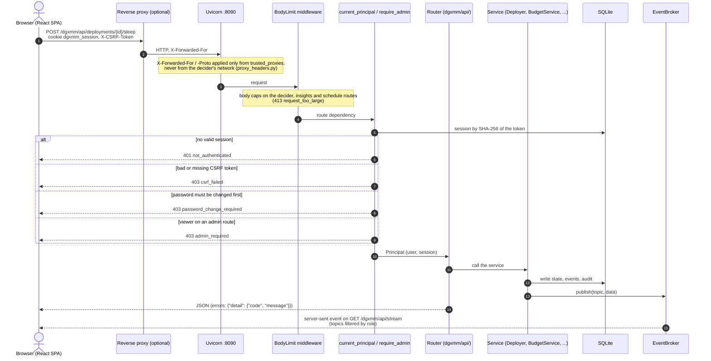
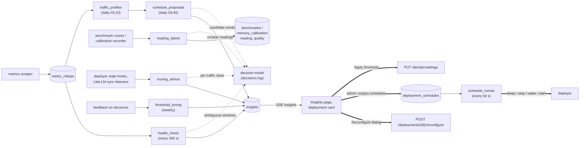

# Request and data flow

## A request through the backend

Every API route is under `/dgxmm/api` (`dgxmm/app.py` mounts the routers with the base path). The browser
sends the session cookie `dgxmm_session` and, on every request other than GET, the session's CSRF token.
A change such as **Sleep** on a deployment goes through these steps:

- **Authentication** (`dgxmm/auth/deps.py`): `current_principal` resolves the session, checks the CSRF
  header on non-GET requests and refuses everything but the password change while `must_change_pw` is
  set. `require_admin` adds the role check. Admin CLI requests arrive on the admin unix socket with a
  short-lived token instead (see [application security model](../security/application.md)).
- **Services** are wired once into an `AppContext` (`dgxmm/context.py`); routers only translate HTTP to
  service calls. Docker is only ever called from `dgxmm/docker_ctl.py`.
- **Live updates** (`dgxmm/events.py`): services publish to an in-process `EventBroker`; each open
  `GET /stream` subscribes, receives the topics its role may see (`dgxmm/api/stream.py`) and drops its
  oldest events when it is too slow. The UI refreshes the matching queries (see [frontend](frontend.md)).

## Data flow

- **Health**: metrics scraper → live samples and rollups → `health_check` (summary, rules, model for
  ambiguous windows) → `insights` (+ `decisions`) → SSE `insights` → Insights page / deployment card →
  Reconfigure dialog → `POST /deployments/{id}/reconfigure` → `POST /insights/{id}/applied`.
- **Schedules**: rollups → `traffic_profiles` (nightly) → candidates → model → proposal insight → admin
  creates schedules → `deployment_schedules` → runner (every minute) → deployer sleep / stop / wake /
  start → deployment events and audit.
- **Readings**: benchmark runner / calibration recorder → listener triggers `reading_labels` → label and
  `quality` on the row → calibration and advice use plausible rows only.
- **Routing**: deployer state hooks and LiteLLM sync listeners → settled trigger → `routing_advice` →
  latest advice (LiteLLM page) and an insight with the snippet. Nothing is written to LiteLLM.
- **Tuning**: feedback on `decisions` → weekly `threshold_tuning` → proposal insight → `PUT
  /api/decider/settings`.

The same flows as a diagram: rules and the model only produce advice and insights; changes still go through
the normal endpoints (bold arrows), and only the schedule runner acts on its own.

## HTTP API

Every route is under `/dgxmm/api` (`dgxmm/api/`). All of them except login need a session; *user* means any
signed-in user (`viewer` or `admin`). With a session, every request other than GET must also send the
session's CSRF token in `X-CSRF-Token`. The UI uses exactly
these routes, so this is also the API for scripts.

| Area | Routes | Role |
|---|---|---|
| Auth | `POST /auth/login`, `POST /auth/logout`, `GET /auth/me`, `POST /auth/change-password` | login: none; others: user |
| Host | `GET /host` (budget, GPU, disk), `GET /host/processes?scope=all\|external\|managed&limit=50` | user |
| Deployments | `GET /deployments`, `GET /deployments/{id}`, `GET /deployments/{id}/litellm` | user |
| | `POST /deployments/preview`, `POST /deployments`, `PATCH /deployments/{id}` (`{"alias": …, "rewrite_keys": true}`), `POST /deployments/{id}/start\|stop\|sleep\|wake\|switch\|reconfigure`, `DELETE /deployments/{id}`, `GET /deployments/{id}/logs` | admin |
| Metrics and advice | `GET /deployments/{id}/metrics`, `GET /host/metrics`, `GET /deployments/{id}/advice`, `GET /deployments/{id}/benchmarks` | user |
| | `POST /deployments/{id}/benchmark` | admin |
| Inventory | `GET /inventory` | user |
| | `POST /inventory/refresh`, `GET /inventory/delete-preview?ref=`, `DELETE /inventory?ref=`, `GET /inventory/cleanup-incomplete/preview`, `POST /inventory/cleanup-incomplete` | admin |
| Catalog and downloads | `GET /catalog/search`, `GET /catalog/details`, `GET /downloads` | user |
| | `POST /downloads`, `POST /downloads/{id}/cancel` | admin |
| Planner | `GET /planner` | user |
| | `PUT /planner/favourites/{ref}`, `DELETE /planner/favourites/{ref}` | admin |
| LiteLLM | `GET /integrations/litellm` (`?probe=false` answers at once with the cached status), `GET /integrations/litellm/status`, `GET /integrations/litellm/models` (API bases only for admins) | user |
| | `PUT /integrations/litellm`, `POST /integrations/litellm/test`, `POST /integrations/litellm/sync`, `GET\|POST /integrations/litellm/keys`, `PATCH\|DELETE /integrations/litellm/keys/{token}` | admin |
| Decision model | `GET /decider/status`, `GET /decider/image`, `GET /deployments/{id}/diagnosis`, `GET /deployments/{id}/workload` | user |
| | `PUT /decider/settings`, `POST /decider/enable` (`{"actions": […]}`), `POST /decider/disable` (`{"remove": true}`), `POST /decider/models/download`, `POST /decider/image/build`, `POST /decider/rotate-key`, `GET /decider/decisions?feature=&limit=`, `POST /decider/decisions/{id}/feedback`, `POST /decider/suggest-config` | admin |
| Engines | `GET /engines` | user |
| Containers | `GET /containers/adoptable`, `POST /containers/{container}/adopt` | admin |
| Users and audit | `GET\|POST /users`, `PATCH\|DELETE /users/{id}`, `GET /audit` | admin |
| Insights | `GET /insights?status=&subject=&kind=` (viewers: viewer-visible features, no actions) | user |
| | `POST /insights/{id}/dismiss`, `POST /insights/{id}/snooze` (`{"hours": 1..168}`), `POST /insights/{id}/applied` | admin |
| Deploy-time advice | `GET /catalog/compat?repo=` | user |
| | `POST /decider/config-advice`, `POST /decider/draft-suggest`, `POST /decider/engine-suggest`, `POST /decider/remote-code-check`, `GET /decider/routing-advice` | admin |
| Schedules | `GET /deployments/{id}/schedules`, `GET /schedules/settings` | user |
| | `POST /deployments/{id}/schedules` (`{"schedules": [{action, days, at_local, timezone}]}`), `PUT /schedules/{id}`, `DELETE /schedules/{id}`, `PUT /schedules/settings` (`{"paused_all": …}`) | admin |
| Commands | `POST /decider/command` (`{"text": …}`, ≤ 300 characters; viewers get navigation only) | user |
| | `GET /decider/free-plans?gib=`, `POST /decider/free-memory` | admin |
| Events | `GET /stream` (server-sent events) | user |

Errors are JSON, `{"detail": {"code": …, "message": …}}`, with a stable `code` (for example
`model_name_taken`, `model_in_use`, `insufficient_memory`, `litellm_no_db`, `image_missing`,
`rate_limited`) and sometimes extra fields such as the deployment that holds a model name. Some
routes are rate-limited and decider request bodies are capped (see
[API limits](../configuration/decision-model.md#api-limits)).

Responses that changed for the decision model: plan options carry `recommended`, `recommendation`
(`source`, `confidence`, `reason`) and `unsafe_reason`; inventory artifacts `kind_source` and
`kind_confidence`; advice items `relevance` and `workload_fit`; deployment views `system` and
`startup_queue` (position and reason while queued). `POST /deployments/{id}/wake` answers `202` when
the wake-up continues in the background. `GET /decider/status` gained `feature_specs` (the registry) and,
for admins, `jobs` (the background jobs).

## Next steps

- [Data model](data-model.md)
- [Frontend](frontend.md)
