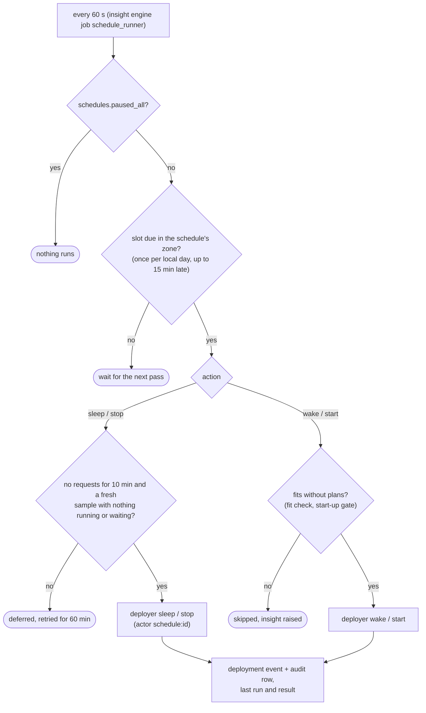

# Schedule runner

`dgxmm/decider/schedule.py` (`ScheduleService`). Schedules (`deployment_schedules`: action, a days
bitmask, `HH:MM`, IANA zone, enabled, creator, last run and result) are created only by an admin, through
`/api/deployments/{id}/schedules` or by accepting a proposal in the UI. Every minute the runner:

1. returns at once while `schedules.paused_all` is set;
2. finds the slots that are due in each schedule's zone (once per local day; up to 15 minutes late);
3. for a sleep or stop, re-checks traffic under the deployment's lock: no request activity for 10
   minutes and a fresh metrics sample with nothing running or waiting; otherwise the slot is deferred and
   retried for 60 minutes;
4. for a wake or start, uses the deployer's normal path (fit check, start-up gate) without plans, so it
   never evicts anything; when it does not fit it is skipped with an insight;
5. records the run as a deployment event with `actor = schedule:<id>` and an audit row.

Stop events carry the `actor` of whoever asked (`DeploymentEvent.actor`). A wake that finds its deployment
stopped starts it only when the latest stop's actor is a schedule; older events without an actor count as
not stopped by a schedule. A failed scheduled sleep or wake pauses that deployment's sleep / wake
schedules. Removing a deployment audits and deletes its schedules (`before_removal_hooks`; the rows go by
`ON DELETE CASCADE`), its traffic profile (cascade) and its insights (a removal hook).

**Proposals.** `traffic_profiles` holds, per deployment and hour of the week, requests per minute (p50 /
p95, from rollups by Little's law), the share of active minutes, observed minutes and weeks, and the weeks
the hour was idle, over the last 30 days. Proposals need 7 local days of data; rules form candidate idle
windows (≥ 2 h, idle in ≥ 90 % of observed weeks, wake 15 minutes before the first active hour), skip
those seen in one week or shorter than 4 h, and the model decides `propose` / `skip` for the rest (at or above
its threshold). When the model cannot be asked (the decision model is disabled or not ready), the rules alone
propose *strong* candidates: idle in every one of at least three observed weeks, every window at least 4 h,
and deployment priority below 90. Such a proposal is marked as coming from the rules (source `rules`, confidence
1.0); every other candidate is not proposed.

## One pass of the runner

## Next steps

- [Schedules (user guide)](../user-guide/schedules.md)
- [Data model](data-model.md)
