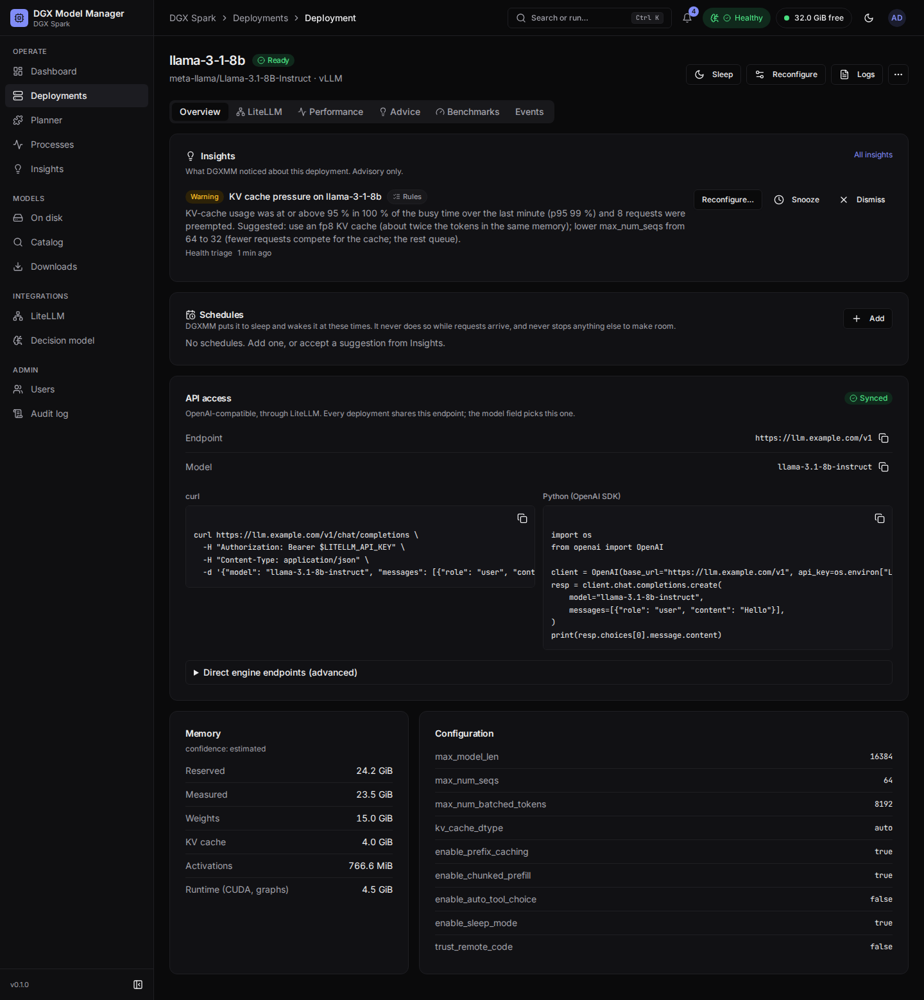
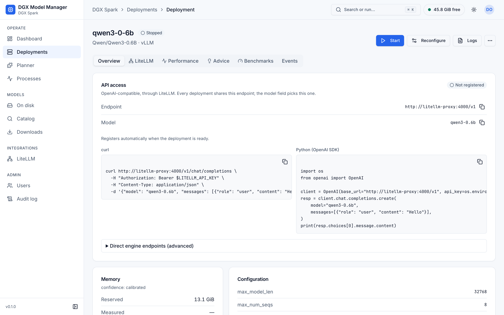
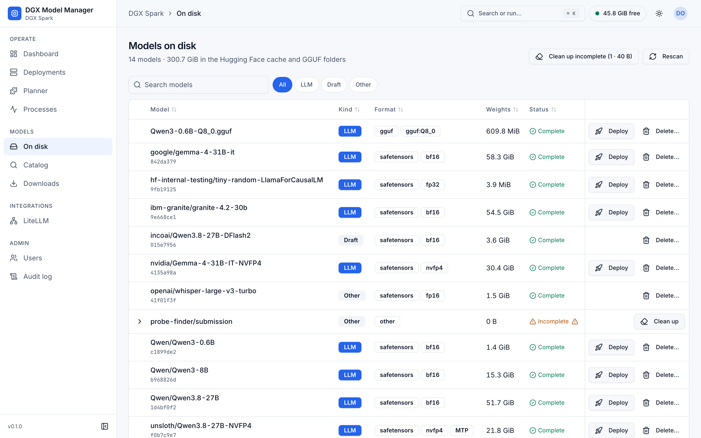
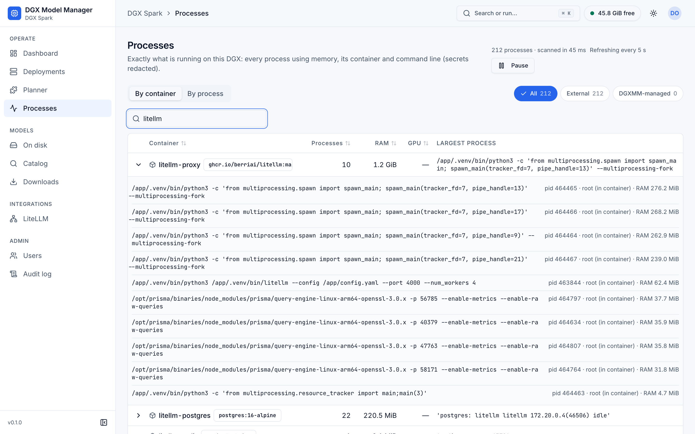
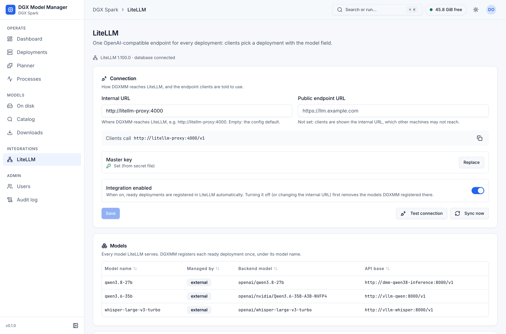
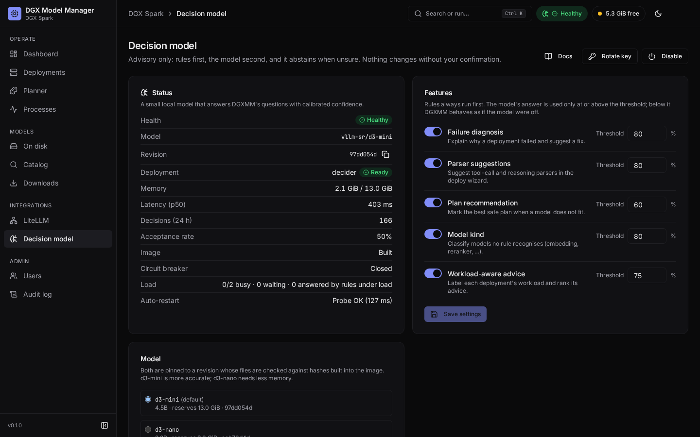
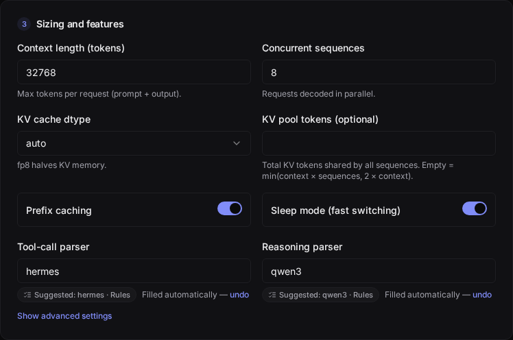
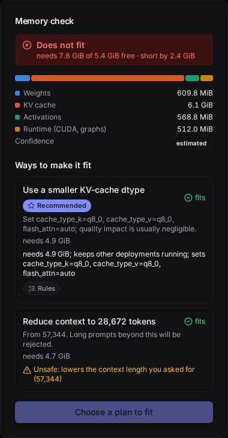

# Using DGXMM

This guide follows the UI from signing in to calling your models. It assumes DGXMM is installed (see the
[README](../README.md#quick-start)).

- [Sign in and roles](#sign-in-and-roles)
- [Dashboard](#dashboard)
- [Deploy a model](#deploy-a-model)
- [Deployment detail](#deployment-detail)
- [Models on disk](#models-on-disk)
- [Catalog and downloads](#catalog-and-downloads)
- [Planner](#planner)
- [Processes](#processes)
- [LiteLLM: one endpoint and virtual keys](#litellm-one-endpoint-and-virtual-keys)
- [Decision model](#decision-model)
- [Users and audit log](#users-and-audit-log)
- [Command palette and keyboard](#command-palette-and-keyboard)
- [Theme and mobile](#theme-and-mobile)
- [Calling your models](#calling-your-models)

## Sign in and roles

Open `http://<host>:8090/dgxmm/` (or your proxy URL) and sign in. On first install the user is
`admin`, and the installer printed its password. It is also saved in `secrets/admin_password`. You must
pick a new password (at least 12 characters) before you can do anything else. The same applies to users
an admin creates or resets.

| Role | Can |
|---|---|
| **viewer** | See the dashboard, deployments (including each one's LiteLLM endpoint and model name), models, catalog, downloads, planner and processes, and run memory checks. Cannot see users, audit log, container logs, the LiteLLM page or virtual keys. |
| **admin** | Everything: deploy, start, stop, sleep, switch, reconfigure, remove, download, delete weights, benchmark, view container logs, configure LiteLLM and manage virtual keys, configure the decision model, manage users, read the audit log. |

After 5 failed sign-ins within a minute (per IP or per username), further attempts are refused for a
minute. Sessions last 12 hours from the last activity. Forgot the admin password? See
[operations](operations.md#forgot-the-admin-password).

## Dashboard


- **Free for new deployments** is the headline number: memory a new model may use right now, after the
  safety margin and OS reserve, what running deployments have reserved, and what other processes use
  (see [memory model](architecture.md#memory-model)). The same figure is in the top bar on every page.
- **Unified memory** bar: one segment per DGXMM deployment, external processes, safety margin + OS
  reserve, and free memory. It also shows GPU utilisation, temperature and free disk. **Table** shows the same numbers as
  a table.
- **KPI tiles**: total generation throughput, the worst time to first token (p50) among ready
  deployments, the highest KV-cache usage, and the request queue.
- **Deployments** table with state, memory (measured / reserved), tok/s, KV usage, and the LiteLLM model
  name with its registration status. When a ready deployment is not registered (for example because
  LiteLLM is unreachable or another deployment holds the same model name), the status has a tooltip
  with the exact reason. A deployment waiting for its turn to start shows *Queued* with its position
  (see [the start-up queue](#the-start-up-queue)). The decision model, when enabled, is listed with a
  **System** badge. Row actions are in the `⋯` menu.
- **Memory over the last hour** chart, and the **largest external memory users**: processes DGXMM does
  not manage. Each row shows the container (or "host"), the pid and user, the command line (hover for the
  full, masked command) and the RAM / GPU split. DGXMM never touches these processes. **View all
  processes** opens the [Processes](#processes) page.
- **Containers not managed by DGXMM** (admins): vLLM containers started by hand. **Adopt settings**
  copies one's model and flags into a new, stopped DGXMM deployment. The original container is left
  alone: stop it before you start the adopted deployment.

A banner appears when memory runs low: *warning* below 1.5 × the safety margin, *critical* below it.

## Deploy a model

Open **Deploy model** (Dashboard, Deployments, or the command palette). It needs the admin role.


1. **Model**: pick a complete, downloaded model. Only models an engine can serve are listed. The line
   below shows the architecture, quantization, weight size and maximum context.

   

2. **Engine and name**: vLLM for safetensors, llama.cpp for GGUF. The **deployment name** becomes the
   container name `dgxmm-<name>` (lowercase letters, digits and `-`). **Priority** (0–100) decides
   eviction order: lower priority is suggested for sleeping or stopping first. **Model name (LiteLLM)**
   is the name clients pass as `model` to the LiteLLM endpoint, such as `default-chat`. It defaults to
   the served name. A model name is 1 to 64 letters, digits and `. _ : / -`. Model names must be unique: if another deployment already uses the name, Deploy is
   refused with a link to that deployment and a one-click suggestion (`<served name>-<deployment name>`).
3. **Sizing and features**: context length, concurrent sequences, KV cache dtype, the shared KV pool
   size, prefix caching, sleep mode and so on. Advanced options include tool-call and reasoning parsers,
   the served model name, and allowlisted extra flags.

The **Memory check** panel updates as you type. It shows the estimate split into weights, KV cache,
activations and runtime, the KV pool in tokens, the vLLM memory share it will be started with, and a
confidence label (`low`, `estimated`, `calibrated` from earlier runs of this model, or `measured` for
this exact configuration).

**If it does not fit**, the panel says by how much and lists **Ways to make it fit**:

- a smaller KV cache dtype (fp8 for vLLM, q8_0 for llama.cpp);
- a shorter context or fewer concurrent sequences;
- a smaller quantization of the same model that is already on disk;
- putting other deployments to sleep, or stopping them. Each deployment that could make room gets its
  own plan (for example *Put chat-small to sleep* or *Stop embed*; up to three sleep and four stop
  plans), plus the smallest combinations of two or three deployments when no single one frees enough.
  The least disruptive come first: deployments that are not busy, then lower priority, then the longest
  idle.

Each option shows what it would need and whether that is enough ("fits" or "still short"). Choosing a
config change edits the form. Choosing sleep or stop arms those actions, and the button becomes
**Apply plan and deploy**. Nothing is stopped until you press it. If memory changed in the meantime,
DGXMM refuses, undoes any actions and shows fresh plans.

Before the plans are shown, a fixed set of safety rules checks each one. A plan is marked
**Unsafe:** with the reason when it would stop or sleep a deployment that is starting or loading,
serving requests or did so in the last 15 minutes, became ready less than 15 minutes ago, has no
metrics for most of that time (its traffic is unknown), is used by another active deployment (for
example as its draft model), has a higher priority than the one you are deploying, or is the decision
model; and when it would lower a context length or sequence count you set yourself, or does not free
enough. Unsafe plans can still be chosen; they are only marked. When exactly one plan is safe it gets a
**Recommended** badge with a short reason; when several are safe, the
[decision model](#plan-recommendation) can pick one of them.

After **Deploy** you land on the deployment's page. It moves through *Starting* → *Loading* → *Ready*.
The first vLLM start of a model can take several minutes, because it compiles kernels (cached for later
starts) and may pull the engine image.

### The start-up queue

Only one engine starts at a time (`max_concurrent_startups`, see
[configuration](configuration.md#engines)). vLLM measures free memory while it starts to size its KV
cache, and on unified memory another engine starting or stopping at the same moment can make that
measurement fail. A deployment you deploy or start while another one is starting waits in state
**Queued**: its memory is already reserved, the page shows its position and what it is waiting for, and
it starts when its turn comes, after a fresh memory check. It fails with a clear message if it no
longer fits, or after waiting 30 minutes (`startup_queue_timeout_s`). **Stop** on a queued deployment
cancels it. Stopping and sleeping are never delayed.

## Deployment detail



Header actions depend on the state (admins only):

| Action | When | What happens |
|---|---|---|
| **Sleep** | ready, vLLM with sleep mode | Frees the KV cache. Weights stay loaded for a fast wake-up. LiteLLM deregisters it while asleep. |
| **Wake** | sleeping | Takes the memory back (only if it is free). Waking re-allocates the KV cache, so it waits for the [start-up queue](#the-start-up-queue) like a start: the page then says *Waiting to wake up*, and the wake-up continues in the background (the API answers `202` after 50 s). |
| **Start** | stopped or failed | Starts again with the stored configuration, after a fresh memory check. |
| **Reconfigure** | ready, sleeping, stopped, failed | Change the configuration with a live memory check. Applying it restarts the deployment. If the new configuration does not come up, the old one is restored. |
| **Logs** | any | The last lines of the engine container log. |
| **Switch model…** (`⋯` menu) | ready or sleeping | Replace this deployment with another model. DGXMM sleeps or stops this one as needed, moves the LiteLLM model name, and rolls back if the new model does not become ready. |
| **Stop** (`⋯`) | running and queued states | Stops and removes the engine container (a queued deployment just leaves the queue). The deployment and its settings are kept. |
| **Remove** (`⋯`) | stopped or failed | Deletes the deployment record. |

Stop and Remove ask for confirmation. **Start** and **Wake** are refused when another running
deployment has taken this one's model name in the meantime; the notice links to that deployment and
offers to set a different model name.

Tabs:

- **Overview**: for a failed deployment, a **Diagnosis** card first (see
  [failure diagnosis](#failure-diagnosis)); then the **API access** card, memory (reserved, measured, estimate parts and confidence), and
  the full configuration. API access shows how clients call this deployment: the single LiteLLM
  **Endpoint** (`…/v1`) and the **Model** name, each with a copy button, the LiteLLM status, and
  ready-to-copy `curl` and Python (OpenAI SDK) snippets that read the key from `LITELLM_API_KEY`. A
  warning appears when the integration is off, the model is not registered yet, or the last sync
  failed. **Direct engine endpoints (advanced)**, collapsed by default, lists the served name and the
  engine URLs on the Docker network and on the host. Those bypass LiteLLM, so no keys, budgets or rate
  limits apply.

  

- **LiteLLM**: the **Model name** (admins can change it; empty means the served name), the
  **Registration** status with a **Re-sync** button, and, for admins, **Keys with access**: the virtual
  keys that can call this model (keys limited to it, and keys for all models), with **Create key for
  this deployment** (the model is preselected). Renaming re-registers the deployment under the new name
  and removes the old one. If keys are limited to the old name, **Also update N key(s)** (on by default)
  rewrites them to the new name, and the result says exactly which keys were updated. Viewers see this
  tab read-only, without keys.
- **Performance**: throughput, time to first token, KV-cache usage, queue, inter-token latency and
  speculative-decoding acceptance. View it live or over 1 h, 24 h, 7 d or 30 d.
- **Advice**: suggestions from the measured metrics and benchmarks. Examples: an fp8 KV cache, an
  NVFP4 variant that is already on disk, speculative decoding with a local draft model, more concurrent
  sequences, a smaller KV pool, chunked prefill, and llama.cpp offload, flash-attention and KV-cache
  settings. **Apply** opens Reconfigure with the change filled in. With 30 minutes or more of traffic
  metrics, a **Workload** label orders the advice (see [workload-aware advice](#workload-aware-advice)).
- **Benchmarks**: **Run benchmark** load-tests the ready deployment at concurrency 1, 4, 8 and 16
  (1024-token prompts, 256-token outputs, at most 60 s and 32 requests per level). Results (total and
  per-request tok/s, TTFT p50/p95, ITL p50) appear as each level finishes and are kept per
  configuration, so you can compare settings. Only one benchmark runs at a time.
- **Events**: every state change with its message. Failures include the container's last log lines
  (secrets in them are masked). An engine that exits with code 137 is labelled *out of memory* only
  when Docker reports an OOM kill or the log has the kernel OOM killer's line; otherwise it says *killed
  by SIGKILL* (for example `docker kill`, or a stop that timed out), and the memory estimate is not
  raised.

## Models on disk



**On disk** lists the models DGXMM found in the Hugging Face cache and the GGUF directories: format,
kind, quantization, size, which engines can serve them, and whether the download is complete
(architecture and context length are shown on wide screens). Filter by kind: **All**, **LLM**,
**Draft** (speculative-decoding draft models such as EAGLE or Medusa) or **Other**. The kind comes
from rules (embeddings, rerankers, speech, vision, drafts and decision models such as classifiers are
recognised from their files); when no rule recognises a model and the decision model is on, the kind
has an **AI** marker whose tooltip gives the model's confidence (see [model kind](#model-kind)). **Deploy** opens the wizard with the model selected. **Rescan** (admins) rescans right
away; otherwise DGXMM rescans every 5 minutes. To add directories, see
[configuration](configuration.md#model-directories).

### Delete weights

**Delete…** (admins) removes a model from disk:

- a Hugging Face model: the whole repo directory in the cache (`models--org--name`, every revision)
  and its lock directory;
- a GGUF file: the file, and all its shards if it is a split GGUF. A parent directory left empty is
  removed too, unless it is a configured model directory.

The dialog first shows what will go: the space it frees, the host paths, and any deployments that use
the model. Type the model's short name (the last part of its name, for example `Qwen3-0.6B`, or the
`.gguf` file name) to confirm.

- A model used by a deployment that is running, starting, loading, sleeping or being started cannot be
  deleted. The dialog names the deployment: stop it first. The same applies while a download of the
  model is queued or running.
- Stopped or failed deployments that use the model are listed as a warning. You can still delete it,
  but those deployments will fail to start until the model is back on disk.
- When another revision of the same repo shares a file, only the link is removed and the dialog says
  that no space is freed for it.
- Newer Hugging Face downloads keep file contents in a shared store in the cache (`hub/blobs`), so that
  identical files are stored once across models. Deleting a model also removes the shared files that
  only that model uses; files another model also uses are kept, and the dialog says how many. The space
  shown counts every file once. If a download reuses one of those files while the deletion runs, that
  file is kept and the notification says so.

The table refreshes when the deletion is done, and a notification shows the space freed. Files owned by
root (left behind by engine containers) are deleted too; see
[how deletion works](architecture.md#deleting-weights).

### Clean up incomplete downloads

Interrupted downloads and models with missing files are marked **Incomplete**. For those rows, admins get
**Clean up** instead of Deploy. When there are any, the header shows **Clean up incomplete (N · size)**,
which lists them all with checkboxes (all selected). Items that cannot be cleaned up right now are
disabled with the reason: a download is running, a deployment uses the model, or a partial file was
written in the last 10 minutes. The same rules apply to a row's **Clean up**: its dialog shows the reason and
keeps the confirm button disabled. Clean up only ever deletes incomplete models, never complete ones.

## Catalog and downloads


**Catalog** searches Hugging Face. Turn on **GGUF (llama.cpp)** to search for GGUF repos, and set the
**Context** the fit badges should assume. Each result shows downloads, approximate size, a **fit**
badge based on memory free right now (*Fits now*, *Fits if you evict* running deployments, *Too big*),
whether vLLM supports the architecture (✓, ✗, or ? when unknown) or llama.cpp applies, and llmfit's
assessment (a ⚠ means llmfit's memory figure differs from DGXMM's by over 20 %). Badges show when a
model is already on disk, gated, or a known quantization.

Open a result for details: the DGXMM memory estimate at your context length, then **Download
safetensors** or a single file from the list of **GGUF files**. Other quantizations of the same model are
listed too. Downloads are refused if they would leave less than `min_free_disk_gib` (50 GiB) free.
Gated models need an [HF token](configuration.md#hugging-face-token).

**Downloads** shows progress, and lets admins cancel. Cancel stops the file being downloaded at once
and removes its partial file; files that already finished are kept. A download interrupted by a DGXMM
restart is marked failed. Start it again: files that already finished are kept. Until every file of a
download is on disk, the model is listed as **Incomplete** (it is not offered for deployment), so a
cancelled or failed download can be resumed or removed with **Clean up**.

## Planner

**Planner** answers "what can I run together?". For a context length per model, it lists the downloaded
models with the memory their default configuration needs. It then lists the best combinations that fit
the capacity: usable memory minus what external processes use, as if no deployment were running.
Combinations with more models rank first, then those with more favourites, then those with more
headroom. Tick **Must include** to only see combinations that contain a model. Admins can star
**favourites**.

## Processes



**Processes** (under Operate, also in the command palette) shows exactly what is running on the box:
every process that uses memory, with its container, user and command line. Everyone who can sign in can
open it; everyone sees the same masked data.

- **By container** (default) groups processes per container, with the image, the total RAM and GPU
  memory and the process count. Processes outside containers are grouped as **host**. Expand a group
  to see its processes.
- **By process** lists them one by one: **Command** (monospace), **Container** (name and image, or
  "host"), **User**, **RAM**, **GPU** and **PID**, biggest first. Expand a row for the full command with
  a copy button, the parent pid, the executable, the uid, the container id and the deployment.
- **Scope**: **All**, **External** (what DGXMM does not manage) or **DGXMM-managed** (its engine
  containers, marked with a **DGXMM** badge). A container that carries DGXMM's labels but is not an
  active deployment is marked **DGXMM-labelled**; its memory counts as external.
- **Search** matches the command, container, image, user and pid.
- The page refreshes every 5 seconds. **Pause** stops that, **Resume** starts it again.

Details:

- Commands are shown with passwords, tokens and keys masked (`***`). Values that cannot be parsed
  reliably are masked as a whole (fail closed), so you may see more `***` than strictly needed. Masking
  is best-effort: it cannot recognise every way a program might take a secret on its command line, so
  avoid passing secrets as arguments and prefer files or environment variables. DGXMM never reads
  process environments.
- Commands longer than 4 KiB are cut, and the details say so.
- Host processes show the host user name. Processes inside containers show the uid as seen inside the
  container, for example `uid 1000 (in container)` or `root (in container)`, because container uids
  are not host accounts.
- Kernel threads, zombie processes and processes using no memory are left out.

## LiteLLM: one endpoint and virtual keys

DGXMM registers every ready deployment in [LiteLLM](https://docs.litellm.ai/) once, under its model
name. Clients then use one OpenAI-compatible endpoint, `<LiteLLM URL>/v1`, and choose the deployment
with `"model": "<model name>"`. LiteLLM adds API keys, budgets, rate limits and logging. To set up the
LiteLLM side, see [configuration](configuration.md#litellm-integration).

The **LiteLLM** page (admins, under Integrations) has three parts. Notices at the top say when LiteLLM
cannot be reached, no master key is set, or the integration is turned off. When LiteLLM is reachable,
its version and database state are shown. The settings appear straight away; the connection status
shows "Checking LiteLLM…" until the probe answers.



**Connection**

- **Internal URL**: how DGXMM reaches LiteLLM, for example `http://litellm-proxy:4000`. Empty means the
  `litellm_url` from `config.yaml`.
- **Public endpoint URL**: what clients use, for example `https://llm.example.com` or
  `http://<dgx-ip>:4000`. The preview below shows the resulting endpoint (`Clients call …/v1`) with a copy
  button. When it is empty, the internal URL is shown instead, with a hint.
- **Master key**: shows whether a key is set and where it comes from (settings or the secret file). The
  key is write-only: **Replace** (or **Set key**) stores a new one, and **Clear** removes a key stored in
  DGXMM so the secret file applies again. A master key is only ever used with the URL it was entered
  for. If you change the internal URL, the page asks you to enter the master key for the new URL.
- **Integration enabled**: when off, deployments are not registered.
- **Turning it off, or changing the internal URL**, first removes the models DGXMM registered in the
  LiteLLM it is leaving (only entries DGXMM created; models added by hand are untouched), using that
  LiteLLM's own master key. The toast says how many were removed. If that LiteLLM cannot be reached, the
  settings are still saved and a warning says how many DGXMM models may remain there and at which URL:
  delete them in that LiteLLM, or re-enable the integration with that URL so DGXMM cleans up.
- **Save** and **Discard changes**. **Test connection** checks that LiteLLM answers and accepts the
  master key, and shows the version, database state and model count. **Sync now** registers and
  removes models right away and reports the counts. Both use the saved settings.

**Models** lists every model LiteLLM knows: its name, which DGXMM deployment it belongs to (with a link
and state) or "external" for models added outside DGXMM, the backend model and its API base.

**Virtual keys** lists LiteLLM's keys: alias, key prefix, the models it may call ("All models" when
unrestricted), spend and budget, rate limits, expiry and creation date. Keys need a LiteLLM database; without
one this part explains how to add it.

- **Create key**: an alias, the models (DGXMM model names, or **All models (including ones added
  later)**), an optional **Max budget (USD)** with **Budget resets every**, **Requests per minute**,
  **Tokens per minute** and **Expires after** (for example `30d`). The new key is shown **once**, with a
  copy button and a `curl` example. Closing the dialog before copying asks for confirmation, because the
  key cannot be shown again.
- **Edit** changes the alias, models, budget and limits, or blocks the key (a blocked key is rejected but
  kept). LiteLLM cannot remove a limit once it is set; set a higher value instead.
- **Revoke** deletes the key after you type its alias. Apps using it stop working immediately.

Keys created in DGXMM are tagged in LiteLLM with `created_by: dgxmm` and your user name. Key changes are
written to the audit log, without the key itself.

## Decision model



The decision model ("decider") is an optional small local model that DGXMM asks for help in five
places: why a deployment failed, which tool-call and reasoning parser a model needs, which plan to
recommend when a model does not fit, what kind of model a checkpoint is, and what workload a deployment
serves. It is **off by default** and purely **advisory**:

- **Rules first.** Each feature has deterministic rules that run whether or not the model is on (the
  diagnosis cards, parser suggestions for known model families, plan safety marks, model kinds and
  workload labels described below all work without it). The model is asked only when no rule answers.
- **Abstains when unsure.** A model answer is used only at or above the feature's confidence threshold.
  Below it, DGXMM behaves as if the model were off.
- **Nothing changes without you.** Answers fill in or mark things in the UI. Every change still goes
  through the normal dialogs (Reconfigure, Deploy, Apply plan), with the memory check, and an admin
  confirms it.
- **Fails open.** When the model is off, starting, overloaded, slow or broken, every feature falls back
  to its rules within its deadline.

The model runs as a *system* deployment named `decider` (container `dgxmm-decider`): it is shown with a
**System** badge, is never stopped or slept by a plan and is never registered in LiteLLM. When it uses
more than its reservation, or when the watchdog has to free memory (with `auto_protect: true`), the
watchdog stops it *before* any of your deployments (see [watchdog](architecture.md#watchdog)); DGXMM
starts it again once memory has recovered. It is managed on the **Decision model** page: its deployment
offers no Switch or Reconfigure, it starts by enabling the decision model, and **Remove** also turns the
decision model off. Its LiteLLM tab and API access card only say that system deployments aren't
registered in LiteLLM. When another model does not fit, the plan chooser notes how much memory the
decision model holds and that disabling it frees that memory (plans never stop it themselves). The top
bar shows a **Decision model** chip with its state (Healthy, Building, Starting, Stopping, Sleeping,
Stopped, Disabled or Error). For admins it opens the **Decision model** page (Integrations > Decision
model, admins only); viewers get a read-only status popup.

### Turn it on

From the UI: open **Integrations > Decision model** and press **Enable**.

1. **Image.** The decider runs from a local image, `dgxmm-decider:3`, built on your machine from
   `deploy/decider` (a pinned vLLM base and hash-pinned Python packages). If it is not built yet, a
   dialog offers **Build image** and shows the build's progress. The first build downloads the base
   image (about 21 GB) and takes a few minutes; then press **Enable now**.
2. **Model files.** The **Model** card lists the supported models; one that is not downloaded yet has a
   **Download** button. It uses the same downloader as the installer and the CLI: only the pinned
   revision's files, each checked against its hash before it is used, and a failed download resumes
   where it stopped when you start it again. Progress shows on the Model card and the Downloads page.
   d3-mini is 8.5 GiB on disk.
3. **Memory.** Enabling deploys the model through the same memory check as any deployment: it reserves
   13 GiB (d3-mini) or 9 GiB (d3-nano). If that does not fit, **Make room for the decision model** lists
   sleep and stop plans; nothing changes until you press **Apply plan and enable**.
4. **Start-up.** The first start compiles GPU kernels and takes a few minutes (2–4 minutes for d3-mini,
   about 90 seconds for d3-nano). It counts as healthy after a health check, an authenticated test
   question and three warm-up questions. While it starts, every feature uses its rules.

From the command line, `./install.sh --with-decider` builds the image, downloads and verifies the model,
enables it and waits until it is healthy (see [operations](operations.md#decision-model)). The admin CLI
`docker exec dgxmm python -m dgxmm.admin decider …` does the same steps one at a time.

### d3-mini or d3-nano

Two models are supported, both pinned to a revision whose files are checked against hashes built into
the image. Measured on a DGX Spark (details in [decider-evaluation.md](decider-evaluation.md#d3-mini-or-d3-nano)):

| | `vllm-sr/d3-mini` (default) | `vllm-sr/d3-nano` |
|---|---|---|
| Size | 4.5B parameters | 2.2B parameters |
| Memory reserved | 13 GiB | 9 GiB |
| Accuracy on the labelled test set | 0.90 | 0.81 |
| Plan ranking | 0.90 | **0.40** |
| Model kinds | 1.00 | 0.70 |
| Parsers (with option descriptions) | 0.92 | 0.96 |
| Latency per question | baseline | 2–3 × faster, about 3 × the throughput |
| Start-up | 2–4 minutes | about 90 seconds |

Keep d3-mini unless memory is tight or the GPU is shared and latency matters. d3-nano ranks plans much
worse (and confuses drafts and speech models with LLMs), but because of the thresholds most of its weak
answers become abstentions rather than wrong suggestions. To switch, pick the model on the **Model**
card, **Save model**, then **Restart with …** (shown while the decider runs). The same deployment is
restarted with the other model; if it fails to start, DGXMM rolls back to the previous model.

### What you see

Every answer carries its source:

- **Rules**: a deterministic rule matched (certain by construction);
- **87% · AI**: the decision model answered, with its confidence;
- nothing, or *Couldn't diagnose confidently*: no rule matched and the model abstained (or is off).

Admins can rate answers with the thumbs up / down buttons (**Helpful** / **Not helpful**) on diagnosis
cards and in the decision log. Feedback does not change answers; it shows whether the thresholds fit
your models (the page shows the **Acceptance rate**).

#### Failure diagnosis

When a deployment fails, a **Diagnosis** card appears at the top of its Overview tab a few seconds
later: the cause (for example *Out of GPU memory*, *KV cache too small for the context*, *Context longer
than the model supports*, *Gated model: Hugging Face token needed*, *Invalid tool-call or reasoning
parser*, *Port already in use*, *Disk full*), its source, a short summary, a fix hint and the redacted
log excerpt. When the cause has a known fix, admins get **Apply fix…**: it opens **Reconfigure** with
the change filled in (for example a shorter `max_model_len`, or a valid parser), so you can review it,
see the memory check and apply it (with automatic rollback). `trust_remote_code: true` is only ever
suggested when a rule found the transformers error that asks for it, and the dialog then warns that the
engine will run the repository's own code. Rules cover 14 causes; the model is asked only when none
matched (threshold 80 %).

#### Parser suggestions

In the deploy wizard, for vLLM models, the **tool-call parser** and **reasoning parser** fields under
advanced options show a suggestion such as **Suggested: hermes · Rules**:




- *Filled automatically — undo*: the field was empty and untouched, and the suggestion comes from a
  strong rule (the model's chat template) or from the model at or above the parser threshold (80 %).
  **undo** clears it.
- **Apply**: a weaker suggestion (a rule from the model's name or family only, or a model answer between
  50 % and the threshold). Nothing is filled until you press it.
- A value you typed is never overwritten. Model answers below 50 % are not shown. A model answer is
  never filled in automatically when the chat template or model name contains text shaped like an
  instruction to the decider.

A wrong parser only makes that deployment fail to start, and the diagnosis then says *Invalid
tool-call or reasoning parser*. The parser questions have a 4 s deadline; the wizard fetches them in the
background.

#### Plan recommendation

When a model does not fit, the plans under **Ways to make it fit** are first checked by the fixed
safety rules described in [Deploy a model](#deploy-a-model). If exactly one plan is safe, it is
**Recommended** by the rules. If several are safe, the decision model ranks only those, and its choice
is recommended when its confidence reaches the plan threshold (60 %), with a reason such as "frees
14.0 GiB; chat-small idle 3 h".



Plan ranking is the weakest of the model's features (d3-mini 0.90 on the labelled set but with little
real-world data; d3-nano 0.40). The safety filter always runs first, so the model only ever chooses
among plans that are already safe: a weak ranking can make a less convenient safe plan the recommended
one, never an unsafe one. Read the plans yourself before you apply one.

#### Model kind

Models on disk are classified as LLM, draft, embedding, reranker, vision LLM, speech, decision (for
example classifiers and guard models) or other. Rules decide for nearly every model. For a model no rule
recognises, the decision model is asked once per snapshot in the background (threshold 80 %), and the
Kind column shows an **AI** marker with its confidence. The kind decides which engines and wizard lists
offer the model.

#### Workload-aware advice

For a ready deployment with at least 30 minutes of metrics in the last hour, DGXMM summarises its
traffic (requests in flight, queueing, prompt and output sizes, idle time) and labels it: *Single-user
chat*, *Agent / tool use*, *Batch throughput*, *Long-context RAG*, *Idle* or *Mixed*. Clear patterns
(for example idle, or a saturated batch) are labelled by rules; otherwise the model is asked (threshold
75 %). The label is shown on the **Advice** tab as **Workload: Batch throughput · 93% · AI**, and the
advice that matters for that workload is listed first under *Most relevant for this workload*. The label
is refreshed every 15 minutes. It only orders the advice; it never applies anything.

### Thresholds and feature switches

The **Features** card on the Decision model page has, per feature, an on/off switch and a
**Threshold** in percent. A switch that is off stops DGXMM from asking the model for that feature; its
rules keep working. Defaults, from the evaluation on real data
([decider-evaluation.md](decider-evaluation.md#thresholds)):

| Feature | Default threshold |
|---|---|
| Failure diagnosis | 80 % |
| Parser suggestions (tool-call and reasoning) | 80 % |
| Plan recommendation | 60 % |
| Model kind | 80 % |
| Workload-aware advice | 75 % |

A higher threshold means fewer but more reliable model answers. Changes apply immediately and are
stored in DGXMM's database (see [configuration](configuration.md#decision-model-runtime-settings)).

### Status and the decision log

The **Status** card shows health, the model and its revision, the decider deployment and its memory,
the median latency, the number of decisions in the last 24 hours, the acceptance rate of rated answers,
whether the image is built, and:

- **Circuit breaker**: after 3 failed questions in a row DGXMM stops asking for 60 seconds and answers by
  rules ("Paused (rules only)"); a successful health probe closes it sooner.
- **Load**: questions at the decider, waiting, and answered by rules because the decider was busy. The
  decider answers one question at a time, so DGXMM keeps at most two at the server; a question that
  cannot start in time is answered by rules at once.
- **Auto-restart**: the supervisor probes the decider every 30 seconds and restarts it after a crash or
  three failed probes, with a growing delay (30 s doubling up to 15 minutes, at most 5 attempts an hour,
  failed ones included, never while memory is low). It never restarts a decider an admin stopped. When
  it gives up, the card says why (**Gave up — …**) and offers **Retry**.

**Recent decisions** lists the last 100 questions, newest first: when, the feature, the subject (a
deployment links to its page), the choice (or *Abstained*), the confidence, the source (Rules, AI or
None), the latency and the feedback buttons. Filter it by feature. The log stores a hash of each
question's input, never the log text or template itself. It keeps 30 days and at most the newest
50 000 rows.

### Turn it off

**Disable** (with confirmation) stops the decider deployment and releases its memory; every feature
continues with its rules. The model files, the image and your settings are kept, so **Enable** brings it
back. To also delete the deployment record, use
`docker exec dgxmm python -m dgxmm.admin decider disable --remove`. With `--with-decider` remembered in
`.env`, the installer leaves a decider you disabled off (see
[operations](operations.md#decision-model)).

### API key and the upgrade banner

DGXMM talks to the decider with a bearer key that it generates itself and never shows. **Rotate key**
writes a new key and restarts a running decider with it (a few minutes, during which the features use
their rules). The same is available as `POST /api/decider/rotate-key` and
`docker exec dgxmm python -m dgxmm.admin rotate-decider-key`.

After a DGXMM upgrade, a decider started by an older version keeps running as it was. When its
container no longer matches what this version expects (another image tag, the key in its environment, a
published port, root user, a writable root filesystem or the wrong network), the page shows a banner
*The running decision model predates this DGXMM version* with the reasons and a button: **Build
image…** if the new image is missing, then **Restart with a new key**. See
[upgrading a decider started by an older build](security.md#upgrading-a-decider-started-by-an-older-build).

## Users and audit log

**Users** (admins): add users with a role and a temporary password, change roles, reset passwords
(users must change the temporary password at next sign-in, and their sessions end), and delete users.
You cannot delete yourself or remove the last admin.

**Audit log** (admins): who did what and when. It covers sign-ins (including failed ones), deploys,
stops, switches, reconfigures, model name changes, downloads, weight deletions and clean-ups (also
refused and failed ones), benchmarks, LiteLLM settings, syncs and key changes, decision-model changes
(enable, disable, settings, image builds, model downloads, key rotations, automatic restarts and
feedback), user changes and watchdog actions. Actions run with the admin CLI are marked `"via": "cli"`.
Filter by action.

## Command palette and keyboard

Press <kbd>⌘</kbd> <kbd>K</kbd> (macOS) or <kbd>Ctrl</kbd> <kbd>K</kbd> (elsewhere), or click
**Search or run…** in the top bar. Type to filter, use the arrow keys, and press <kbd>Enter</kbd> to run:

- go to any page;
- **Deploy a model**, or **Deploy &lt;model&gt;** for each deployable model on disk (admins);
- **Open**, **Sleep**, **Wake** or **Stop** a deployment (Stop asks for confirmation);
- switch the theme (light, dark, system), change your password, or log out.

## Theme and mobile

The sun/moon button in the top bar switches between light and dark. The default follows your system
setting, and the choice is remembered per browser. The sidebar can be collapsed with the button at its
bottom.

On a phone the layout adapts: tables become cards, dialogs become bottom sheets, and a tab bar gives
quick access to Home, Deploys, Models and More.


## Calling your models

**Through LiteLLM** (recommended): all deployments share one OpenAI-compatible endpoint
(`/v1/chat/completions`, `/v1/completions`, `/v1/models`), and the `model` field picks the deployment.
The **API access** card on a deployment's Overview tab shows the endpoint and model name and has
ready-made snippets. Create a key on the deployment's LiteLLM tab or the LiteLLM page:

```bash
curl https://llm.example.com/v1/chat/completions \
  -H "Authorization: Bearer $LITELLM_API_KEY" \
  -H 'Content-Type: application/json' \
  -d '{"model": "default-chat", "messages": [{"role": "user", "content": "Hello!"}]}'
```

```python
import os
from openai import OpenAI

client = OpenAI(base_url="https://llm.example.com/v1", api_key=os.environ["LITELLM_API_KEY"])
reply = client.chat.completions.create(model="default-chat",
                                       messages=[{"role": "user", "content": "Hello!"}])
print(reply.choices[0].message.content)
```

Each deployment is registered once, under its model name: the **Model name (LiteLLM)** you set, or
the served name. A stable model name makes model changes invisible to clients: deploy with model name
`default-chat`, and use **Switch model…** later. The name moves to the new deployment once it is ready.

**Directly** (advanced): each engine also serves the same API under its served model name, without
keys, budgets or rate limits. The engines have no authentication, which is why their ports are only
published on the host's loopback interface.

- From the DGX itself, use the "On the DGX" endpoint, for example
  `curl http://127.0.0.1:8100/v1/chat/completions -H 'Content-Type: application/json' -d '{"model": "qwen3-0.6b", "messages": [{"role": "user", "content": "Hello!"}]}'`.
- From another container on the DGXMM Docker network, use `http://dgxmm-<deployment name>:<port>/v1`.

Both are listed under **Direct engine endpoints (advanced)** on the Overview tab.
