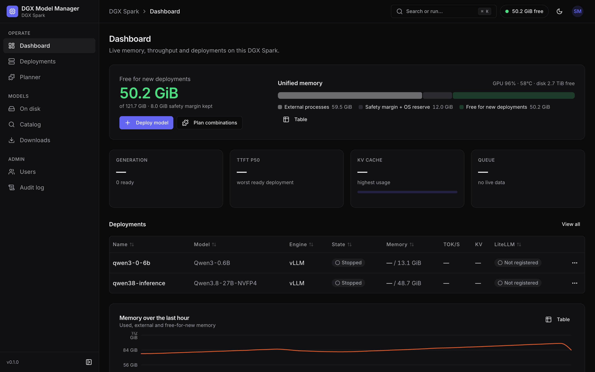
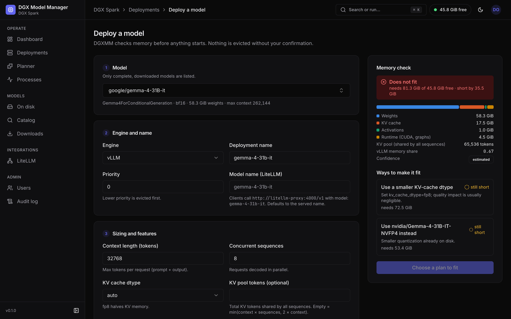
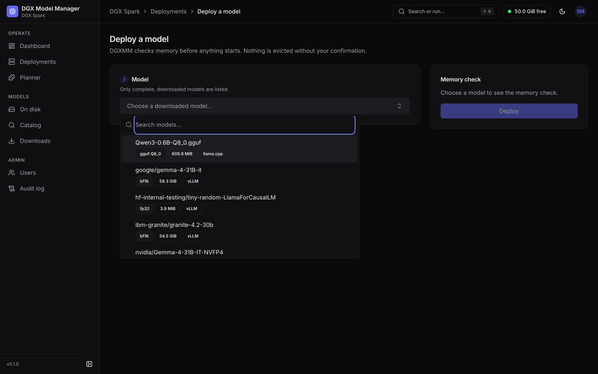
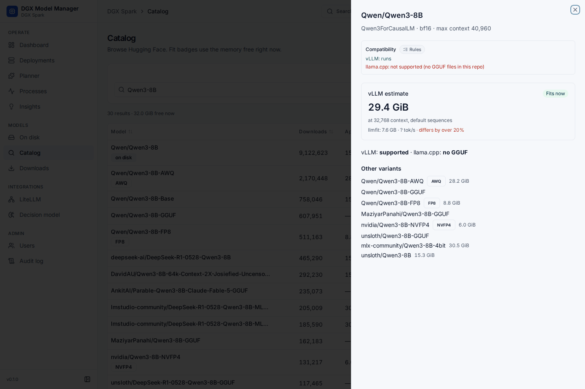
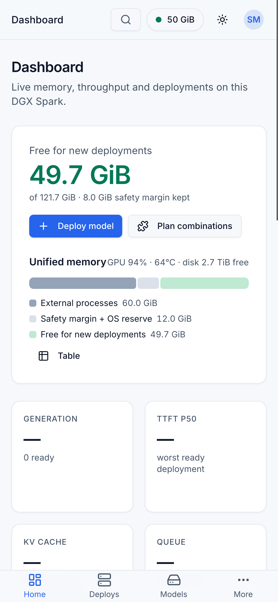

# Using DGXMM

This guide follows the UI from signing in to calling your models. It assumes DGXMM is installed (see the
[README](../README.md#quick-start)).

- [Sign in and roles](#sign-in-and-roles)
- [Dashboard](#dashboard)
- [Deploy a model](#deploy-a-model)
- [Deployment detail](#deployment-detail)
- [Models on disk](#models-on-disk)
- [Catalog and downloads](#catalog-and-downloads)
- [Planner](#planner)
- [Processes](#processes)
- [LiteLLM: one endpoint and virtual keys](#litellm-one-endpoint-and-virtual-keys)
- [Users and audit log](#users-and-audit-log)
- [Command palette and keyboard](#command-palette-and-keyboard)
- [Theme and mobile](#theme-and-mobile)
- [Calling your models](#calling-your-models)

## Sign in and roles

Open `http://<host>:8090/dgxmm/` (or your proxy URL) and sign in. On first install the user is
`admin`, and the installer printed its password. It is also saved in `secrets/admin_password`. You must
pick a new password (at least 12 characters) before you can do anything else. The same applies to users
an admin creates or resets.

| Role | Can |
|---|---|
| **viewer** | See the dashboard, deployments (including each one's LiteLLM endpoint and model name), models, catalog, downloads, planner and processes, and run memory checks. Cannot see users, audit log, container logs, the LiteLLM page or virtual keys. |
| **admin** | Everything: deploy, start, stop, sleep, switch, reconfigure, remove, download, delete weights, benchmark, view container logs, configure LiteLLM and manage virtual keys, manage users, read the audit log. |

After 5 failed sign-ins within a minute (per IP or per username), further attempts are refused for a
minute. Sessions last 12 hours from the last activity. Forgot the admin password? See
[operations](operations.md#forgot-the-admin-password).

## Dashboard



- **Free for new deployments** is the headline number: memory a new model may use right now, after the
  safety margin and OS reserve, what running deployments have reserved, and what other processes use
  (see [memory model](architecture.md#memory-model)). The same figure is in the top bar on every page.
- **Unified memory** bar: one segment per DGXMM deployment, external processes, safety margin + OS
  reserve, and free memory. It also shows GPU utilisation, temperature and free disk. **Table** shows the same numbers as
  a table.
- **KPI tiles**: total generation throughput, the worst time to first token (p50) among ready
  deployments, the highest KV-cache usage, and the request queue.
- **Deployments** table with state, memory (measured / reserved), tok/s, KV usage, and the LiteLLM model
  name with its registration status. When a ready deployment is not registered (for example because
  LiteLLM is unreachable or another deployment holds the same model name), the status has a tooltip
  with the exact reason. Row actions are in the `⋯` menu.
- **Memory over the last hour** chart, and the **largest external memory users**: processes DGXMM does
  not manage. Each row shows the container (or "host"), the pid and user, the command line (hover for the
  full, masked command) and the RAM / GPU split. DGXMM never touches these processes. **View all
  processes** opens the [Processes](#processes) page.
- **Containers not managed by DGXMM** (admins): vLLM containers started by hand. **Adopt settings**
  copies one's model and flags into a new, stopped DGXMM deployment. The original container is left
  alone: stop it before you start the adopted deployment.

A banner appears when memory runs low: *warning* below 1.5 × the safety margin, *critical* below it.

## Deploy a model

Open **Deploy model** (Dashboard, Deployments, or the command palette). It needs the admin role.



1. **Model**: pick a complete, downloaded model. Only models an engine can serve are listed. The line
   below shows the architecture, quantization, weight size and maximum context.

   

2. **Engine and name**: vLLM for safetensors, llama.cpp for GGUF. The **deployment name** becomes the
   container name `dgxmm-<name>` (lowercase letters, digits and `-`). **Priority** (0–100) decides
   eviction order: lower priority is suggested for sleeping or stopping first. **Model name (LiteLLM)**
   is the name clients pass as `model` to the LiteLLM endpoint, such as `default-chat`. It defaults to
   the served name. Model names must be unique: if another deployment already uses the name, Deploy is
   refused with a link to that deployment and a one-click suggestion (`<served name>-<deployment name>`).
3. **Sizing and features**: context length, concurrent sequences, KV cache dtype, the shared KV pool
   size, prefix caching, sleep mode and so on. Advanced options include tool-call and reasoning parsers,
   the served model name, and allowlisted extra flags.

The **Memory check** panel updates as you type. It shows the estimate split into weights, KV cache,
activations and runtime, the KV pool in tokens, the vLLM memory share it will be started with, and a
confidence label (`low`, `estimated`, `calibrated` from earlier runs of this model, or `measured` for
this exact configuration).

**If it does not fit**, the panel says by how much and lists **Ways to make it fit**:

- a smaller KV cache dtype (fp8 for vLLM, q8_0 for llama.cpp);
- a shorter context or fewer concurrent sequences;
- a smaller quantization of the same model that is already on disk;
- putting lower-priority deployments to sleep, or stopping them.

Each option shows what it would need and whether that is enough ("fits" or "still short"). Choosing a
config change edits the form. Choosing sleep or stop arms those actions, and the button becomes
**Apply plan and deploy**. Nothing is stopped until you press it. If memory changed in the meantime,
DGXMM refuses, undoes any actions and shows fresh plans.

After **Deploy** you land on the deployment's page. It moves through *Starting* → *Loading* → *Ready*.
The first vLLM start of a model can take several minutes, because it compiles kernels (cached for later
starts) and may pull the engine image.

## Deployment detail

Header actions depend on the state (admins only):

| Action | When | What happens |
|---|---|---|
| **Sleep** | ready, vLLM with sleep mode | Frees the KV cache. Weights stay loaded for a fast wake-up. LiteLLM deregisters it while asleep. |
| **Wake** | sleeping | Takes the memory back (only if it is free). |
| **Start** | stopped or failed | Starts again with the stored configuration, after a fresh memory check. |
| **Reconfigure** | ready, sleeping, stopped, failed | Change the configuration with a live memory check. Applying it restarts the deployment. If the new configuration does not come up, the old one is restored. |
| **Logs** | any | The last lines of the engine container log. |
| **Switch model…** (`⋯` menu) | ready or sleeping | Replace this deployment with another model. DGXMM sleeps or stops this one as needed, moves the LiteLLM model name, and rolls back if the new model does not become ready. |
| **Stop** (`⋯`) | running states | Stops and removes the engine container. The deployment and its settings are kept. |
| **Remove** (`⋯`) | stopped or failed | Deletes the deployment record. |

Stop and Remove ask for confirmation. **Start** and **Wake** are refused when another running
deployment has taken this one's model name in the meantime; the notice links to that deployment and
offers to set a different model name.

Tabs:

- **Overview**: the **API access** card, memory (reserved, measured, estimate parts and confidence), and
  the full configuration. API access shows how clients call this deployment: the single LiteLLM
  **Endpoint** (`…/v1`) and the **Model** name, each with a copy button, the LiteLLM status, and
  ready-to-copy `curl` and Python (OpenAI SDK) snippets that read the key from `LITELLM_API_KEY`. A
  warning appears when the integration is off, the model is not registered yet, or the last sync
  failed. **Direct engine endpoints (advanced)**, collapsed by default, lists the served name and the
  engine URLs on the Docker network and on the host. Those bypass LiteLLM, so no keys, budgets or rate
  limits apply.
- **LiteLLM**: the **Model name** (admins can change it; empty means the served name), the
  **Registration** status with a **Re-sync** button, and, for admins, **Keys with access**: the virtual
  keys that can call this model (keys limited to it, and keys for all models), with **Create key for
  this deployment** (the model is preselected). Renaming re-registers the deployment under the new name
  and removes the old one. If keys are limited to the old name, **Also update N key(s)** (on by default)
  rewrites them to the new name, and the result says exactly which keys were updated. Viewers see this
  tab read-only, without keys.
- **Performance**: throughput, time to first token, KV-cache usage, queue, inter-token latency and
  speculative-decoding acceptance. View it live or over 1 h, 24 h, 7 d or 30 d.
- **Advice**: suggestions from the measured metrics and benchmarks. Examples: an fp8 KV cache, an
  NVFP4 variant that is already on disk, speculative decoding with a local draft model, more concurrent
  sequences, a smaller KV pool, chunked prefill, and llama.cpp offload, flash-attention and KV-cache
  settings. **Apply** opens Reconfigure with the change filled in.
- **Benchmarks**: **Run benchmark** load-tests the ready deployment at concurrency 1, 4, 8 and 16
  (1024-token prompts, 256-token outputs, at most 60 s and 32 requests per level). Results (total and
  per-request tok/s, TTFT p50/p95, ITL p50) appear as each level finishes and are kept per
  configuration, so you can compare settings. Only one benchmark runs at a time.
- **Events**: every state change with its message. Failures include the container's last log lines.

## Models on disk

**On disk** lists the models DGXMM found in the Hugging Face cache and the GGUF directories: format,
architecture, quantization, size, which engines can serve them, and whether the download is complete.
Filter by kind. **Deploy** opens the wizard with the model selected. **Rescan** (admins) rescans right
away; otherwise DGXMM rescans every 5 minutes. To add directories, see
[configuration](configuration.md#model-directories).

### Delete weights

**Delete…** (admins) removes a model from disk:

- a Hugging Face model: the whole repo directory in the cache (`models--org--name`, every revision)
  and its lock directory;
- a GGUF file: the file, and all its shards if it is a split GGUF. A parent directory left empty is
  removed too, unless it is a configured model directory.

The dialog first shows what will go: the space it frees, the host paths, and any deployments that use
the model. Type the model's short name (the last part of its name, for example `Qwen3-0.6B`, or the
`.gguf` file name) to confirm.

- A model used by a deployment that is running, starting, loading, sleeping or being started cannot be
  deleted. The dialog names the deployment: stop it first. The same applies while a download of the
  model is queued or running.
- Stopped or failed deployments that use the model are listed as a warning. You can still delete it,
  but those deployments will fail to start until the model is back on disk.
- When another revision of the same repo shares a file, only the link is removed and the dialog says
  that no space is freed for it.

The table refreshes when the deletion is done, and a notification shows the space freed. Files owned by
root (left behind by engine containers) are deleted too; see
[how deletion works](architecture.md#deleting-weights).

### Clean up incomplete downloads

Interrupted downloads and models with missing files are marked **Incomplete**. For those rows, admins get
**Clean up** instead of Deploy. When there are any, the header shows **Clean up incomplete (N · size)**,
which lists them all with checkboxes (all selected). Items that cannot be cleaned up right now are
disabled with the reason: a download is running, a deployment uses the model, or a partial file was
written in the last 10 minutes. The same rules apply to a row's **Clean up**: its dialog shows the reason and
keeps the confirm button disabled. Clean up only ever deletes incomplete models, never complete ones.

## Catalog and downloads



**Catalog** searches Hugging Face. Turn on **GGUF (llama.cpp)** to search for GGUF repos, and set the
**Context** the fit badges should assume. Each result shows downloads, approximate size, a **fit**
badge based on memory free right now (*Fits now*, *Fits if you evict* running deployments, *Too big*),
whether vLLM supports the architecture (✓, ✗, or ? when unknown) or llama.cpp applies, and llmfit's
assessment (a ⚠ means llmfit's memory figure differs from DGXMM's by over 20 %). Badges show when a
model is already on disk, gated, or a known quantization.

Open a result for details: the DGXMM memory estimate at your context length, then **Download
safetensors** or a single file from the list of **GGUF files**. Other quantizations of the same model are
listed too. Downloads are refused if they would leave less than `min_free_disk_gib` (50 GiB) free.
Gated models need an [HF token](configuration.md#hugging-face-token).

**Downloads** shows progress, and lets admins cancel. A download interrupted by a DGXMM restart is
marked failed. Start it again: files that already finished are kept.

## Planner

**Planner** answers "what can I run together?". For a context length per model, it lists the downloaded
models with the memory their default configuration needs. It then lists the best combinations that fit
the capacity: usable memory minus what external processes use, as if no deployment were running.
Combinations with more models rank first, then those with more favourites, then those with more
headroom. Tick **Must include** to only see combinations that contain a model. Admins can star
**favourites**.

## Processes

**Processes** (under Operate, also in the command palette) shows exactly what is running on the box:
every process that uses memory, with its container, user and command line. Everyone who can sign in can
open it; everyone sees the same masked data.

- **By container** (default) groups processes per container, with the image, the total RAM and GPU
  memory and the process count. Processes outside containers are grouped as **host**. Expand a group
  to see its processes.
- **By process** lists them one by one: **Command** (monospace), **Container** (name and image, or
  "host"), **User**, **RAM**, **GPU** and **PID**, biggest first. Expand a row for the full command with
  a copy button, the parent pid, the executable, the uid, the container id and the deployment.
- **Scope**: **All**, **External** (what DGXMM does not manage) or **DGXMM-managed** (its engine
  containers, marked with a **DGXMM** badge). A container that carries DGXMM's labels but is not an
  active deployment is marked **DGXMM-labelled**; its memory counts as external.
- **Search** matches the command, container, image, user and pid.
- The page refreshes every 5 seconds. **Pause** stops that, **Resume** starts it again.

Details:

- Commands are shown with passwords, tokens and keys masked (`***`). Values that cannot be parsed
  reliably are masked as a whole (fail closed), so you may see more `***` than strictly needed. Masking
  is best-effort: it cannot recognise every way a program might take a secret on its command line, so
  avoid passing secrets as arguments and prefer files or environment variables. DGXMM never reads
  process environments.
- Commands longer than 4 KiB are cut, and the details say so.
- Host processes show the host user name. Processes inside containers show the uid as seen inside the
  container, for example `uid 1000 (in container)` or `root (in container)`, because container uids
  are not host accounts.
- Kernel threads, zombie processes and processes using no memory are left out.

## LiteLLM: one endpoint and virtual keys

DGXMM registers every ready deployment in [LiteLLM](https://docs.litellm.ai/) once, under its model
name. Clients then use one OpenAI-compatible endpoint, `<LiteLLM URL>/v1`, and choose the deployment
with `"model": "<model name>"`. LiteLLM adds API keys, budgets, rate limits and logging. To set up the
LiteLLM side, see [configuration](configuration.md#litellm-integration).

The **LiteLLM** page (admins, under Integrations) has three parts. Notices at the top say when LiteLLM
cannot be reached, no master key is set, or the integration is turned off. When LiteLLM is reachable,
its version and database state are shown. The settings appear straight away; the connection status
shows "Checking LiteLLM…" until the probe answers.

**Connection**

- **Internal URL**: how DGXMM reaches LiteLLM, for example `http://litellm-proxy:4000`. Empty means the
  `litellm_url` from `config.yaml`.
- **Public endpoint URL**: what clients use, for example `https://llm.example.com` or
  `http://<dgx-ip>:4000`. The preview below shows the resulting endpoint (`Clients call …/v1`) with a copy
  button. When it is empty, the internal URL is shown instead, with a hint.
- **Master key**: shows whether a key is set and where it comes from (settings or the secret file). The
  key is write-only: **Replace** (or **Set key**) stores a new one, and **Clear** removes a key stored in
  DGXMM so the secret file applies again. A master key is only ever used with the URL it was entered
  for. If you change the internal URL, the page asks you to enter the master key for the new URL.
- **Integration enabled**: when off, deployments are not registered.
- **Turning it off, or changing the internal URL**, first removes the models DGXMM registered in the
  LiteLLM it is leaving (only entries DGXMM created; models added by hand are untouched), using that
  LiteLLM's own master key. The toast says how many were removed. If that LiteLLM cannot be reached, the
  settings are still saved and a warning says how many DGXMM models may remain there and at which URL:
  delete them in that LiteLLM, or re-enable the integration with that URL so DGXMM cleans up.
- **Save** and **Discard changes**. **Test connection** checks that LiteLLM answers and accepts the
  master key, and shows the version, database state and model count. **Sync now** registers and
  removes models right away and reports the counts. Both use the saved settings.

**Models** lists every model LiteLLM knows: its name, which DGXMM deployment it belongs to (with a link
and state) or "external" for models added outside DGXMM, the backend model and its API base.

**Virtual keys** lists LiteLLM's keys: alias, key prefix, the models it may call ("All models" when
unrestricted), spend and budget, rate limits, expiry and creation date. Keys need a LiteLLM database; without
one this part explains how to add it.

- **Create key**: an alias, the models (DGXMM model names, or **All models (including ones added
  later)**), an optional **Max budget (USD)** with **Budget resets every**, **Requests per minute**,
  **Tokens per minute** and **Expires after** (for example `30d`). The new key is shown **once**, with a
  copy button and a `curl` example. Closing the dialog before copying asks for confirmation, because the
  key cannot be shown again.
- **Edit** changes the alias, models, budget and limits, or blocks the key (a blocked key is rejected but
  kept). LiteLLM cannot remove a limit once it is set; set a higher value instead.
- **Revoke** deletes the key after you type its alias. Apps using it stop working immediately.

Keys created in DGXMM are tagged in LiteLLM with `created_by: dgxmm` and your user name. Key changes are
written to the audit log, without the key itself.

## Users and audit log

**Users** (admins): add users with a role and a temporary password, change roles, reset passwords
(users must change the temporary password at next sign-in, and their sessions end), and delete users.
You cannot delete yourself or remove the last admin.

**Audit log** (admins): who did what and when. It covers sign-ins (including failed ones), deploys,
stops, switches, reconfigures, model name changes, downloads, weight deletions and clean-ups (also
refused and failed ones), benchmarks, LiteLLM settings, syncs and key changes, user changes and watchdog
actions. Filter by action.

## Command palette and keyboard

Press <kbd>⌘</kbd> <kbd>K</kbd> (macOS) or <kbd>Ctrl</kbd> <kbd>K</kbd> (elsewhere), or click
**Search or run…** in the top bar. Type to filter, use the arrow keys, and press <kbd>Enter</kbd> to run:

- go to any page;
- **Deploy a model**, or **Deploy &lt;model&gt;** for each deployable model on disk (admins);
- **Open**, **Sleep**, **Wake** or **Stop** a deployment (Stop asks for confirmation);
- switch the theme (light, dark, system), change your password, or log out.

## Theme and mobile

The sun/moon button in the top bar switches between light and dark. The default follows your system
setting, and the choice is remembered per browser. The sidebar can be collapsed with the button at its
bottom.

On a phone the layout adapts: tables become cards, dialogs become bottom sheets, and a tab bar gives
quick access to Home, Deploys, Models and More.



## Calling your models

**Through LiteLLM** (recommended): all deployments share one OpenAI-compatible endpoint
(`/v1/chat/completions`, `/v1/completions`, `/v1/models`), and the `model` field picks the deployment.
The **API access** card on a deployment's Overview tab shows the endpoint and model name and has
ready-made snippets. Create a key on the deployment's LiteLLM tab or the LiteLLM page:

```bash
curl https://llm.example.com/v1/chat/completions \
  -H "Authorization: Bearer $LITELLM_API_KEY" \
  -H 'Content-Type: application/json' \
  -d '{"model": "default-chat", "messages": [{"role": "user", "content": "Hello!"}]}'
```

```python
import os
from openai import OpenAI

client = OpenAI(base_url="https://llm.example.com/v1", api_key=os.environ["LITELLM_API_KEY"])
reply = client.chat.completions.create(model="default-chat",
                                       messages=[{"role": "user", "content": "Hello!"}])
print(reply.choices[0].message.content)
```

Each deployment is registered once, under its model name: the **Model name (LiteLLM)** you set, or
the served name. A stable model name makes model changes invisible to clients: deploy with model name
`default-chat`, and use **Switch model…** later. The name moves to the new deployment once it is ready.

**Directly** (advanced): each engine also serves the same API under its served model name, without
keys, budgets or rate limits. The engines have no authentication, which is why their ports are only
published on the host's loopback interface.

- From the DGX itself, use the "On the DGX" endpoint, for example
  `curl http://127.0.0.1:8100/v1/chat/completions -H 'Content-Type: application/json' -d '{"model": "qwen3-0.6b", "messages": [{"role": "user", "content": "Hello!"}]}'`.
- From another container on the DGXMM Docker network, use `http://dgxmm-<deployment name>:<port>/v1`.

Both are listed under **Direct engine endpoints (advanced)** on the Overview tab.
